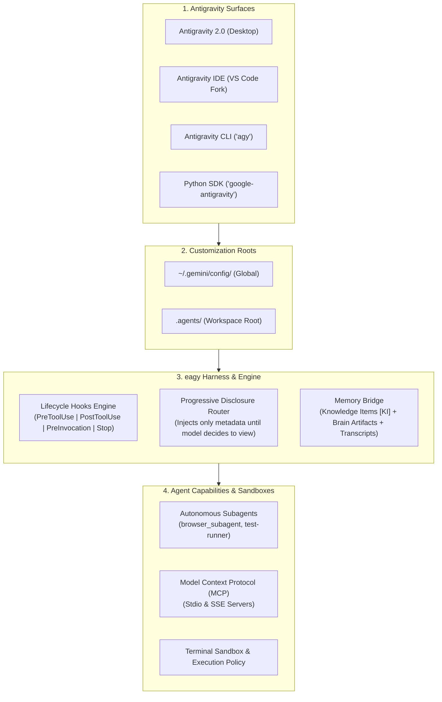

# 🪐 Everything Gemini ()

<div align="center">

[](LICENSE)
[](https://antigravity.google)
[](package.json)
[](https://github.com/salmanshaikh/everything-gemini)
[](CONTRIBUTING.md)

**The open-source agent harness, multi-agent orchestrator, and performance ecosystem for Google Gemini & Antigravity.**

*Inspired by [Affan Mustafa's Everything Claude Code (ECC)](https://github.com/affaan-m/everything-claude-code), re-engineered and native-built for Google Antigravity (AGY).*

[Quickstart](#-quickstart) • [Why eagy?](#-why-eagy) • [Architecture](#-architecture--internals) • [Customization Matrix](#-customization-catalog) • [Surfaces Guide](#-the-4-antigravity-surfaces) • [Contributing](CONTRIBUTING.md)

</div>

---

## ⚡ What is `eagy`?

**Google Antigravity** is Google’s state-of-the-art AI-first coding platform, powered by Gemini models, an event-driven execution loop (Cortex), progressive disclosure, multi-surface orchestration (Desktop 2.0, VS Code-based IDE, `agy` CLI, and Python SDK), and localized Knowledge Items (KI).

Out of the box, Antigravity is a formidable pair programmer. But without structured harnesses, agents can suffer from:
- **Context bloat**: Loading massive guidelines into every prompt turn, eroding the model's reasoning window.
- **Unchecked execution risks**: Accidentally running destructive terminal commands or pushing unfinished code.
- **Premature stops**: Quitting multi-step tasks before tests pass or edge cases are verified.
- **Amnesia between sessions**: Forgetting architectural lessons learned yesterday.

**Everything Antigravity (`eagy`)** solves this. It provides a battle-tested harness system consisting of:
1. 🛡️ **Safety Shield & Lifecycle Hooks (`hooks.json`)**: Deterministic gating for destructive commands, auto-lint formatters, and stop-guard verifiers.
2. 🧠 **Progressive Disclosure Skills (`skills/`)**: On-demand procedural playbooks that load *only* when needed, saving up to **85% in token overhead**.
3. 📏 **Hierarchical Rules (`GEMINI.md` / `AGENTS.md`)**: Context-aware coding standards, zero-hallucination protocols, and clean-architecture rules.
4. 🔌 **Plug-and-Play Plugins (`plugins/`)**: Domain bundles for Fullstack Web, Python AI, DevOps, and Security.
5. 🌐 **Curated MCP Servers (`mcp/`)**: Pre-configured connections for GitHub, PostgreSQL, SQLite, and Documentation scrapers.
6. 🤖 **Subagent & Browser Automation**: Specialized recipes for autonomous browser subagents with automated WebP recording.

---

## 🚀 Quickstart

### 1. One-Line Interactive Installer

Run this in your terminal to install `eagy` globally or into your current project:

```bash
# macOS / Linux
curl -fsSL https://raw.githubusercontent.com/salmanshaikh/everything-gemini/main/scripts/install.sh | bash
```

```powershell
# Windows (PowerShell)
irm https://raw.githubusercontent.com/salmanshaikh/everything-gemini/main/scripts/install.ps1 | iex
```

### 2. Via `eagy` CLI (Zero-Dependency)

```bash
# Clone the repository
git clone https://github.com/salmanshaikh/everything-gemini.git
cd eagy

# Run the eagy harness CLI
./bin/everything-gemini install --profile developer
```

### 3. Installation Profiles

| Profile | Target Audience | What Gets Installed |
| :--- | :--- | :--- |
| **`core`** | Minimalists & Speed | Safety-shield hook, TDD skill, repo-onboarding skill, baseline `GEMINI.md`. |
| **`developer`** *(Recommended)* | Daily Software Engineers | Core + Fullstack Web plugin, Python AI plugin, Git Craftsman, Auto-formatter hook, Stop verifier hook. |
| **`full`** | Lead Engineers & Archs | Everything: all plugins, full skills catalog, all lifecycle hooks, pre-tested MCP configs, and templates. |

---

## 🏗️ Architecture & Internals

`eagy` is engineered specifically around Google Antigravity's internal execution engine:



### Key Differences: ECC vs. EAGY

| Feature | Everything Claude Code (ECC) | Everything Antigravity (EAGY) |
| :--- | :--- | :--- |
| **Target Platform** | Claude Code CLI & harnesses | Antigravity 2.0 Desktop, IDE, `agy` CLI, Python SDK |
| **Model Engine** | Claude 3.5 / 3.7 Sonnet | Gemini 3.8 / 3.x Flash & Pro |
| **Context Protocol** | Direct markdown prompts | **Progressive Disclosure** (Metadata injected first, bodies lazy-loaded) |
| **Memory System** | Flat markdown files | **Knowledge Items (KI)** + **Dual Transcripts** (`transcript.jsonl` vs `transcript_full.jsonl`) |
| **UI Artifacts** | Standard text output | **Rich Brain Artifacts** (Interactive alerts, mermaid diagrams, carousels, live diffs) |
| **Browser Execution** | Bash browser wrappers | **Native `browser_subagent`** with automated WebP recording |
| **Lifecycle Hooks** | Shell scripts | Typed protojson contracts (`PreToolUse`, `PostToolUse`, `PreInvocation`, `PostInvocation`, `Stop`) |
| **Tool Integration** | Claude tool use | **MCP standard (Stdio & SSE)** with auto-discovery & namespacing |

---

## 📂 Repository Directory Layout

```text
eagy/
├── bin/
│   └── eagy                      # Zero-dependency harness CLI
├── scripts/
│   ├── install.sh                # Interactive shell installer (macOS/Linux)
│   ├── install.ps1               # PowerShell installer (Windows)
│   └── validate.sh               # Linter/validator for skills, hooks, and configs
├── plugins/                      # Reusable modular plugins
│   ├── core/                     # Foundational safety and workflows
│   ├── web-fullstack/            # Modern Next.js/React/Vite/TypeScript suite
│   ├── python-ai/                # Python, PyTorch, and Antigravity SDK
│   └── security-shield/          # Hardened safety gates & secret protection
├── skills/                       # Progressive disclosure skills library
│   ├── tdd-workflow/             # Red-Green-Refactor with auto-testing
│   ├── browser-qa-tester/        # Autonomous browser UI testing with WebP capture
│   ├── architecture-designer/    # System architecture, C4 & Mermaid blueprints
│   ├── repo-onboarding/          # Fast codebase indexing into Knowledge Items (KI)
│   ├── performance-profiler/     # Latency diagnosis & bottleneck tracing
│   ├── git-craftsman/            # Conventional commits, micro-diffs, clean PRs
│   ├── security-audit/           # OWASP Top 10, dependency checks & secret audit
│   └── fullstack-nextjs/         # Next.js App Router, SSR, Server Actions
├── rules/                        # Contextual guidelines & standards
│   ├── common/                   # Universal rules (GEMINI.md & AGENTS.md)
│   ├── languages/                # TypeScript, Python, Go, Rust
│   └── paradigms/                # TDD, Security-hardened, Clean Architecture
├── hooks/                        # Event-driven lifecycle hooks (hooks.json)
│   ├── safety-shield/            # PreToolUse destructive command blocker
│   ├── auto-lint-formatter/      # PostToolUse automatic formatting
│   ├── goal-verifier/            # Stop hook preventing unfinished stops
│   └── ephemeral-context/        # PreInvocation smart context injection
├── mcp/                          # Production-ready MCP server blueprints
│   ├── mcp_config.example.json   # GitHub, SQLite, PostgreSQL, Docs fetcher
│   └── README.md                 # MCP configuration & security guide
├── docs/                         # The Comprehensive Antigravity Bible
│   ├── architecture/             # Cortex loop, Progressive disclosure, Memory
│   ├── surfaces/                 # Desktop 2.0, IDE, CLI, Python SDK
│   ├── customization/            # Skills, Rules, Hooks, MCP guides
│   └── workflows/                # Slash commands, Subagents, Browser QA
└── templates/                    # Starter templates
    ├── minimal/                  # 1-file GEMINI.md + safety hook
    ├── recommended/              # Balanced developer configuration
    └── full-power/               # Enterprise complete setup
```

---

## 🧰 Customization Catalog

### 🤖 Scoped Sub-Agents ()

Everything Gemini provides specialized subagent specifications designed for Antigravity's native  delegation and Python SDK orchestration:

| Subagent | Role | Focus Area |
| :--- | :--- | :--- |
| **[](agents/planner.md)** | Strategic Planner | Dependency mapping, impact radius analysis, phased checklists. |
| **[](agents/code-reviewer.md)** | Quality Auditor | Edge case verification, type safety, regression prevention, minimal diffs. |
| **[](agents/build-repair.md)** | Build Triage Specialist | Compiler error diagnosis, test failure auto-repair, surgical fixes. |
| **[](agents/browser-qa.md)** | Automated Visual QA | Native browser testing with automated WebP recording into artifacts. |
| **[](agents/security-auditor.md)** | Security Auditor | Credential scanning, OWASP Top 10, dependency audit, permission gates. |
| **[](agents/architect.md)** | Systems Architect | C4 Mermaid blueprints, sequence diagrams, and formal ADR records. |


### 1. Skills (`skills/`)
Skills in Antigravity are lazy-loaded runbooks. Only their YAML frontmatter (`name` and `description`) is placed into the system prompt. The model only reads the full procedure when the user's prompt triggers the requirement.

- **[`tdd-workflow`](skills/tdd-workflow/SKILL.md)**: Strict test-first engineering loop. Disallows writing production code before an existing failing test reproduces the requirement.
- **[`browser-qa-tester`](skills/browser-qa-tester/SKILL.md)**: Launches the native `browser_subagent` to click, type, verify layout, and inspect console logs, capturing a session video into artifacts.
- **[`architecture-designer`](skills/architecture-designer/SKILL.md)**: Generates clear Mermaid diagrams, sequence flows, and ADRs (Architecture Decision Records).
- **[`repo-onboarding`](skills/repo-onboarding/SKILL.md)**: Automatically scans a new repository and writes a structured Knowledge Item (`<appDataDir>/knowledge`) to give the agent permanent recall of your architecture.
- **[`git-craftsman`](skills/git-craftsman/SKILL.md)**: Enforces conventional commits, crafts atomic diffs, and writes PR summaries linked with file references.
- **[`security-audit`](skills/security-audit/SKILL.md)**: Scans for credentials in commit history, tests for injection vulnerabilities, and verifies dependencies.
- **[`performance-profiler`](skills/performance-profiler/SKILL.md)**: Identifies CPU/memory bottlenecks, analyzes database queries, and optimizes critical paths.
- **[`fullstack-nextjs`](skills/fullstack-nextjs/SKILL.md)**: Best practices for React Server Components, hydration fixes, and API routes.

### 2. Lifecycle Hooks (`hooks/`)
Hooks run shell scripts at critical lifecycle events with typed JSON contracts on `stdin`/`stdout`:

- **Safety Shield (`PreToolUse`)**: Intercepts `run_command` and inspects `CommandLine`. Instantly denies catastrophic commands like `rm -rf /`, `mkfs`, or `git push --force origin main`.
- **Auto Lint Formatter (`PostToolUse`)**: Triggered after file modifications. Runs your project's linter/formatter (`prettier`, `black`, `ruff`, `gofmt`) automatically so code is always clean.
- **Goal Verifier (`Stop`)**: Intercepts the agent's attempt to finish. If test suites are failing or background tasks are unfinished, it returns `{"decision": "continue", "reason": "Tests are still failing. Fix them before stopping."}`.
- **Ephemeral Context Injector (`PreInvocation`)**: Injects transient warnings or guidelines before each model reasoning step without cluttering persistent conversation history.

### 3. Rules Hierarchy (`rules/`)
Antigravity automatically discovers rules by walking up from the current file's directory to the repository root:
- **`rules/common/GEMINI.md`**: Foundational instructions for precision, minimal changes, and strict verification.
- **`rules/languages/typescript.md`**: Strict TypeScript, Zod validations, no `any`, modern ESM.
- **`rules/languages/python.md`**: Python 3.12+, type hints, Pydantic v2, Ruff formatting.
- **`rules/paradigms/security-hardened.md`**: Defense-in-depth, zero-trust file access, credential hygiene.

---

## 🖥️ The 4 Antigravity Surfaces

Antigravity operates across four interconnected surfaces. `eagy` supports all of them seamlessly:

```
+-----------------------------------------------------------------------------------+
|                                 GOOGLE ANTIGRAVITY                                |
+-------------------------+-------------------------+-------------------------------+
|  1. Antigravity 2.0     |  2. Antigravity IDE     |  3. Antigravity CLI ('agy')   |
|  (Desktop App)          |  (VS Code Fork)         |  (Terminal & Headless)        |
|  - Unified Left Sidebar |  - Antigravity Tab      |  - Fast interactive TUI       |
|  - Chat Canvas          |    (Autocomplete/Super) |  - Headless scripting         |
|  - Auxiliary Panes      |  - Inline (Cmd+I)       |  - Automated CI pipes         |
|    (Subagents, Artifacts|  - Code Lenses & Diffs  |  - Settings JSON              |
+-------------------------+-------------------------+-------------------------------+
|                      4. Python SDK ('google-antigravity')                         |
|  - Programmatic leasing  - Streaming thoughts deltas  - Custom tool wiring        |
+-----------------------------------------------------------------------------------+
```

1. **Antigravity 2.0 (Desktop Application)**: The flagship Electron desktop application. Supports scheduled tasks (cron/timers), background process monitoring, visual artifact viewers, and slash commands.
2. **Antigravity IDE**: Standalone AI-first integrated editor based on VS Code. Features **Antigravity Tab** (next-intent prediction), **Inline Edits (`Cmd+I`)**, **Code Lenses**, and **Diagnostic Auto-Fix**.
3. **Antigravity CLI (`agy`)**: High-speed terminal TUI for keyboard-driven workflows and headless script automation.
4. **Antigravity Python SDK (`google-antigravity`)**: Public Python SDK allowing developers to build custom agents, stream reasoning tokens (`response.thoughts`), and wire custom tools.

---

## 🪄 Slash Commands Playbook

Antigravity provides built-in slash commands in chat that activate specialized cognitive modes:

| Command | Purpose | How `eagy` Enhances It |
| :--- | :--- | :--- |
| **`/goal <task>`** | Long-running autonomous mode | Pairs with `eagy`'s **Goal Verifier Hook** to prevent premature termination until test suites pass. |
| **`/plan <task>`** | Step-by-step implementation blueprint | Enforces architectural review, risk assessment, and mermaid diagrams before code edits. |
| **`/grill-me`** | Interactive design interview | Asks hard architectural and trade-off questions to resolve ambiguities before implementing. |
| **`/learn`** | Persist feedback across sessions | Automatically indexes insights into a permanent Knowledge Item (`<appDataDir>/knowledge`). |
| **`/schedule`** | One-shot or recurring background tasks | Sets up cron monitors or health-check agents with reactive wakeup. |

---

## 📊 Token Efficiency & Benchmark

Traditional agent harnesses dump dozens of prompt files into the system prompt on every single turn. Antigravity's **Progressive Disclosure** paired with `eagy` avoids this:

```
[Traditional Setup]
System Prompt: Base Instructions + All 25 Skills (Full Text) + All Rules = ~45,000 Tokens / turn

[eagy on Antigravity]
System Prompt: Base Instructions + 25 Skill Summaries (YAML) + Directory Rules = ~3,200 Tokens / turn
Skill Body: Loaded on-demand ONLY when invoked = ~1,500 Tokens (one-time)
Savings: > 85% Token Reduction & 3x Faster First-Token Latency!
```

---

## 🛠️ Usage & CLI Reference

The zero-dependency `eagy` CLI manages your configurations effortlessly:

```bash
# Verify your installation and check for conflicts
./bin/everything-gemini doctor

# Install a specific profile into the current workspace (.agents/)
./bin/everything-gemini install --profile developer

# Install globally for all projects (~/.gemini/config/)
./bin/everything-gemini install --global --profile core

# List all available skills, rules, hooks, and plugins
./bin/everything-gemini list

# Add a specific skill to your active workspace
./bin/everything-gemini add skill tdd-workflow

# Add a specific plugin
./bin/everything-gemini add plugin web-fullstack

# Validate all schemas and frontmatter
./bin/everything-gemini validate
```

---

## 🤝 Contributing

We welcome community contributions! You can contribute new **Skills**, **Rules**, **Lifecycle Hooks**, **MCP Blueprints**, or **Plugins**.

See [CONTRIBUTING.md](CONTRIBUTING.md) for full development guidelines, YAML frontmatter standards, and validation procedures.

---

## 📄 License

This project is licensed under the [Apache 2.0 License](LICENSE).

<div align="center">
Made with 💙 by the Antigravity Community.
</div>
