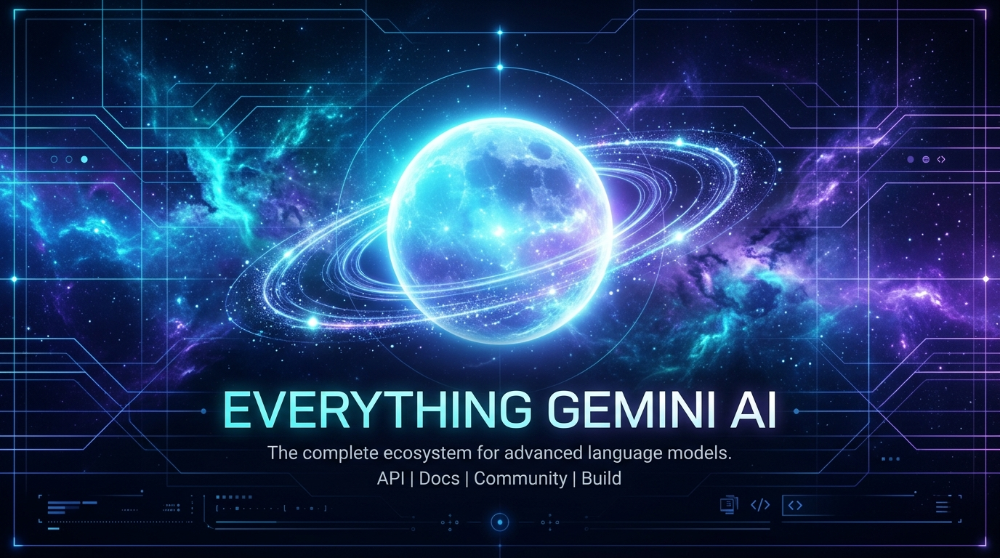
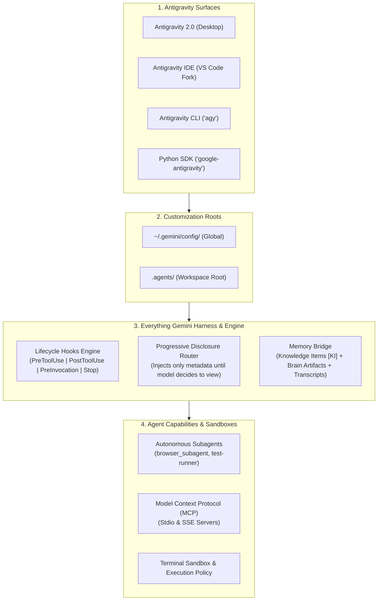

# 🪐 Everything Gemini (everything-gemini)

<div align="center">



[](https://salmandev.github.io/everything-gemini/)
[](https://www.npmjs.com/package/everything-gemini)
[](https://github.com/salmandev/everything-gemini/actions/workflows/ci.yml)
[](https://github.com/salmandev/everything-gemini/actions/workflows/ci.yml)
[](https://github.com/salmandev/everything-gemini)
[](LICENSE)
[](https://antigravity.google)
[](https://github.com/salmandev/everything-gemini)
[](CONTRIBUTING.md)

**The open-source agent harness, multi-agent orchestrator, and performance ecosystem for Google Gemini & Antigravity.**

[Live Interactive Showcase](https://salmandev.github.io/everything-gemini/) • [Quickstart](#-quickstart) • [What is everything-gemini?](#-what-is-everything-gemini) • [Architecture](#-architecture--internals) • [Customization Catalog](#-customization-catalog) • [Surfaces Guide](#-the-4-antigravity-surfaces) • [Contributing](CONTRIBUTING.md)

</div>

---

## ⚡ What is Everything Gemini?

**Google Antigravity** is Google’s state-of-the-art AI-first coding platform, powered by Gemini models, an event-driven execution loop (Cortex), progressive disclosure, multi-surface orchestration (Desktop 2.0, VS Code-based IDE, `agy` CLI, and Python SDK), and localized Knowledge Items (KI).

Out of the box, Antigravity is a formidable pair programmer. But without structured harnesses, agents can suffer from:
- **Context bloat**: Loading massive guidelines into every prompt turn, eroding the model's reasoning window.
- **Unchecked execution risks**: Accidentally running destructive terminal commands or pushing unfinished code.
- **Premature stops**: Quitting multi-step tasks before tests pass or edge cases are verified.
- **Amnesia between sessions**: Forgetting architectural lessons learned yesterday.

**Everything Gemini (`everything-gemini`)** solves this. It provides a battle-tested harness system consisting of:
1. 🛡️ **Safety Shield & Lifecycle Hooks (`hooks.json`)**: Deterministic gating for destructive commands, auto-lint formatters, and stop-guard verifiers.
2. 🧠 **Progressive Disclosure Skills (`skills/`)**: On-demand procedural playbooks that load *only* when needed, saving up to **85% in token overhead**.
3. 📏 **Hierarchical Rules (`GEMINI.md` / `AGENTS.md`)**: Context-aware coding standards, zero-hallucination protocols, and clean-architecture rules.
4. 🔌 **Plug-and-Play Plugins (`plugins/`)**: Domain bundles for Fullstack Web, Python AI, DevOps, and Security.
5. 🌐 **Curated MCP Servers (`mcp/`)**: Production blueprints for Persistent Semantic Memory (`@modelcontextprotocol/server-memory`), High-Performance Cache (`@modelcontextprotocol/server-redis`), Web Fetch (`server-fetch`), GitHub, PostgreSQL, and SQLite.
6. 🤖 **Subagent & Browser Automation**: Specialized recipes for autonomous browser subagents with automated WebP recording.

---

## 🚀 Quickstart

### 1. Instant Installation via npx (Zero Setup)

Run this directly in any project directory or terminal:

```bash
npx everything-gemini install
```

### 2. One-Line Interactive Installer

```bash
# macOS / Linux
curl -fsSL https://raw.githubusercontent.com/salmandev/everything-gemini/main/scripts/install.sh | bash
```

```powershell
# Windows (PowerShell)
irm https://raw.githubusercontent.com/salmandev/everything-gemini/main/scripts/install.ps1 | iex
```

### 3. Via Repository Clone
```bash
# Clone the repository
git clone https://github.com/salmandev/everything-gemini.git
cd everything-gemini

# Run the Everything Gemini CLI
./bin/everything-gemini install --profile developer
```

### 4. Installation Profiles

| Profile | Target Audience | What Gets Installed |
| :--- | :--- | :--- |
| **`core`** | Minimalists & Speed | Safety-shield hook, TDD skill, repo-onboarding skill, baseline `GEMINI.md`. |
| **`developer`** *(Recommended)* | Daily Software Engineers | Core + 6 Scoped Subagents (`agents/`), Frontier Skills (Multimodal vision, 2M context caching, Subagent handoff, Security audit), Fullstack & Python AI plugins, Auto-formatter & Goal-verifier hooks. |
| **`full`** | Lead Engineers & Archs | Everything: all 33 progressive skills, 6 scoped subagents, full lifecycle hooks suite (6 hooks), all plugins, MCP configs, and templates. |

### 5. In CI / GitHub Actions Workflows

Automate Everything Gemini skill, subagent, and lifecycle safety hook provisioning directly in your CI pipelines using our official composite action:

```yaml
- name: Setup Everything Gemini
  uses: salmandev/everything-gemini@v1
  with:
    profile: developer # core | developer | full
    global: false      # true for ~/.gemini/config/, false for active workspace .agents/
```

---

## 🏗️ Architecture & Internals

`everything-gemini` is engineered specifically around Google Antigravity's internal execution engine:



### Key Differences: ECC vs. Everything Gemini

> 📖 **Read the Comprehensive Architectural Breakdown**: [Everything Claude Code (ECC) vs. Everything Gemini](docs/ecc-vs-everything-gemini.md)

| Feature | Everything Claude Code (ECC) | Everything Gemini (`everything-gemini`) |
| :--- | :--- | :--- |
| **Target Platform** | Claude Code CLI & harnesses | Antigravity 2.0 Desktop, IDE, `agy` CLI, Python SDK |
| **Model Engine** | Claude 3.5 / 3.7 Sonnet | Gemini 3.8 / 1.5 Flash & Pro |
| **Context Protocol** | Direct markdown prompts | **Progressive Disclosure** (Metadata injected first, bodies lazy-loaded) |
| **Context Window & Caching** | 200k tokens, ephemeral | **1M-2M+ tokens with Native Prefix Context Caching (~75% cost savings)** |
| **Memory System** | Flat markdown files | **Knowledge Items (KI)** + **Adaptive Learned Instincts** |
| **UI & Visual Multimodality** | Standard text output | **Native `browser_subagent` + WebP Screen Video Recording + Vision** |
| **Subagents Fleet** | Manual sub-prompts | **6 Scoped Subagents (`agents/`) with Formal Handoff Protocol** |
| **Lifecycle Hooks** | Shell scripts | Typed protojson contracts (`PreToolUse`, `PostToolUse`, `PreInvocation`, `PostInvocation`, `Stop`) |
| **Tool Integration** | Claude tool use | **MCP standard (Stdio & SSE)** with auto-discovery & namespacing |

---

## 📂 Repository Directory Layout

```text
everything-gemini/
├── .github/                      # CI/CD workflows & issue templates
├── bin/                          # Zero-dependency harness & scaffolding CLI
├── agents/                       # Scoped subagent fleet (Planner, Reviewer, Architect, etc.)
├── scripts/                      # Automated installers and harness validators
├── plugins/                      # Reusable modular plugins (web-fullstack, python-ai, security)
├── skills/                       # 33 Progressive disclosure skills (31 core + 2 plugins)
├── rules/                        # Contextual guidelines & standards
├── hooks/                        # Event-driven lifecycle hooks (GeminiShield, Auto-lint)
├── mcp/                          # Production-ready MCP server blueprints
├── docs/                         # The Comprehensive Antigravity Bible
└── templates/                    # Starter templates (minimal, recommended, full-power)
```

---

## 🧰 Customization Catalog

### 🤖 Scoped Sub-Agents (`agents/`)

Everything Gemini provides specialized subagent specifications designed for Antigravity's native `invoke_subagent` delegation and Python SDK orchestration:

| Subagent | Role | Focus Area |
| :--- | :--- | :--- |
| **[`planner`](agents/planner.md)** | Strategic Planner | Dependency mapping, impact radius analysis, phased checklists. |
| **[`code-reviewer`](agents/code-reviewer.md)** | Quality Auditor | Edge case verification, type safety, regression prevention, minimal diffs. |
| **[`build-repair`](agents/build-repair.md)** | Build Triage Specialist | Compiler error diagnosis, test failure auto-repair, surgical fixes. |
| **[`browser-qa`](agents/browser-qa.md)** | Automated Visual QA | Native browser testing with automated WebP recording into artifacts. |
| **[`security-auditor`](agents/security-auditor.md)** | Security Auditor | Credential scanning, OWASP Top 10, dependency audit, permission gates. |
| **[`architect`](agents/architect.md)** | Systems Architect | C4 Mermaid blueprints, sequence diagrams, and formal ADR records. |

### 1. Skills (`skills/`)
Skills in Antigravity are lazy-loaded runbooks. Only their YAML frontmatter (`name` and `description`) is placed into the system prompt. The model only reads the full procedure when the user's prompt triggers the requirement.

- **[`gemini-multimodal`](skills/gemini-multimodal/SKILL.md)**: Native visual reasoning over mockups, diagrams, and automated WebP browser recordings.
- **[`context-caching`](skills/context-caching/SKILL.md)**: 1M-2M token context optimization, static prefix caching, and repository indexing.
- **[`gemini-grounding`](skills/gemini-grounding/SKILL.md)**: Real-time Google Search grounding, live documentation retrieval, and fact-checking.
- **[`rag-architect`](skills/rag-architect/SKILL.md)**: RAG pipeline design, AST semantic chunking, hybrid vector-keyword retrieval, and Gemini re-ranking.
- **[`gemini-function-calling`](skills/gemini-function-calling/SKILL.md)**: Production function declarations, structured JSON output schemas (Pydantic), and parallel tool dispatch.
- **[`ai-first-engineering`](skills/ai-first-engineering/SKILL.md)**: Requirement decomposition, executable acceptance criteria (BDD), and blast-radius containment.
- **[`agent-evals`](skills/agent-evals/SKILL.md)**: Automated evaluation pipelines, LLM-as-a-judge scoring, golden test datasets, and prompt regression testing.
- **[`github-ops`](skills/github-ops/SKILL.md)**: GitHub workflow automation, PR generation, code review triage, and semantic releases with `gh` CLI & GitHub MCP.
- **[`subagent-handoff`](skills/subagent-handoff/SKILL.md)**: Multi-agent task delegation protocol, scoped contexts, and report synthesis.
- **[`api-craftsman`](skills/api-craftsman/SKILL.md)**: REST, OpenAPI 3.1 specifications, gRPC protos, and RFC 7807 error envelopes.
- **[`database-architect`](skills/database-architect/SKILL.md)**: Zero-downtime migrations, concurrent indexing, and ACID schema modeling.
- **[`fastapi-production`](skills/fastapi-production/SKILL.md)**: Production async FastAPI architecture, Pydantic v2 schemas, lifespan handlers, and health probes.
- **[`redis-cache-patterns`](skills/redis-cache-patterns/SKILL.md)**: Enterprise Redis caching strategies, distributed locking with atomic Lua, and sliding-window rate limiting.
- **[`svelte-kit-architect`](skills/svelte-kit-architect/SKILL.md)**: Modern SvelteKit apps with Svelte 5 runes ($state, $derived, $effect), SSR/prerender, and form actions.
- **[`fullstack-nextjs`](skills/fullstack-nextjs/SKILL.md)**: Next.js App Router, React Server Components (RSC), hydration error diagnosis, and Server Actions.
- **[`graphql-architect`](skills/graphql-architect/SKILL.md)**: Schema-first GraphQL APIs, DataLoader N+1 query batching, and Relay cursor pagination.
- **[`supabase-architect`](skills/supabase-architect/SKILL.md)**: Row Level Security (RLS) policies, pgvector embeddings, and edge function workflows.
- **[`cloudflare-workers`](skills/cloudflare-workers/SKILL.md)**: Serverless edge functions, Wrangler v3, D1 SQL, and KV low-latency storage.
- **[`docker-compose-orchestrator`](skills/docker-compose-orchestrator/SKILL.md)**: Multi-container local environments (Postgres + pgvector, Redis) with healthchecks.
- **[`kubernetes-operator`](skills/kubernetes-operator/SKILL.md)**: Production k8s manifests, HPA autoscaling, zero-downtime rolling updates, and health probes.
- **[`stripe-integration`](skills/stripe-integration/SKILL.md)**: Webhook signature verification, idempotent payments, and customer portal session flows.
- **[`devops-pipeline`](skills/devops-pipeline/SKILL.md)**: Multi-stage Dockerfiles and caching GitHub Actions CI/CD workflows.
- **[`root-cause-debugger`](skills/root-cause-debugger/SKILL.md)**: Regression diagnosis using binary search (`git bisect`) and minimal reproduction harnesses.
- **[`tdd-workflow`](skills/tdd-workflow/SKILL.md)**: Red-Green-Refactor loop with automated test runners.
- **[`browser-qa-tester`](skills/browser-qa-tester/SKILL.md)**: Autonomous browser UI testing with WebP capture into artifacts.
- **[`architecture-designer`](skills/architecture-designer/SKILL.md)**: System architecture, C4 & Mermaid blueprints.
- **[`repo-onboarding`](skills/repo-onboarding/SKILL.md)**: Fast codebase indexing into Knowledge Items (KI).
- **[`git-craftsman`](skills/git-craftsman/SKILL.md)**: Enforces conventional commits, atomic diffs, and clean PR descriptions.
- **[`security-audit`](skills/security-audit/SKILL.md)**: Scans for credentials in commit history and audits dependency risks.
- **[`performance-profiler`](skills/performance-profiler/SKILL.md)**: Identifies CPU/memory bottlenecks, analyzes database queries, and critical paths.
- **[`continuous-learning`](skills/continuous-learning/SKILL.md)**: Codifies corrections and developer feedback into enduring Knowledge Items.
- **[`antigravity-sdk-orchestrator`](plugins/python-ai/skills/antigravity-sdk-orchestrator/SKILL.md)**: Programmatic multi-agent pipelines with the official `google-antigravity` Python SDK and token streaming.
- **[`responsive-design`](plugins/web-fullstack/skills/responsive-design/SKILL.md)**: Fluid typography, mobile-first flex/grid layouts, media queries, and cross-browser accessibility.

### 2. Lifecycle Hooks (`hooks/`)
Hooks run shell scripts at critical lifecycle events with typed JSON contracts on `stdin`/`stdout`:

- **[`gemini-shield`](hooks/gemini-shield/hooks.json) (`PreToolUse`)**: Deterministic safety firewall intercepting `run_command` and denying catastrophic operations like `rm -rf /`, `mkfs`, or `git push --force origin main`.
- **[`safety-shield`](hooks/safety-shield/hooks.json) (`PreToolUse`)**: Intercepts `run_command` and inspects `CommandLine` against strict security guidelines before shell execution.
- **[`auto-lint-formatter`](hooks/auto-lint-formatter/hooks.json) (`PostToolUse`)**: Triggered after file modifications. Runs your project's linter/formatter (`prettier`, `black`, `ruff`, `gofmt`) automatically so code is always clean.
- **[`goal-verifier`](hooks/goal-verifier/hooks.json) (`Stop`)**: Intercepts the agent's attempt to finish. If test suites are failing or background tasks are unfinished, it returns `{"decision": "continue", "reason": "Tests are still failing. Fix them before stopping."}`.
- **[`ephemeral-context`](hooks/ephemeral-context/hooks.json) (`PreInvocation`)**: Injects transient warnings or guidelines before each model reasoning step without cluttering persistent conversation history.
- **[`learned-instincts`](hooks/learned-instincts/hooks.json)**: Session learning hook that records developer corrections and feedback into persistent instincts.

### 3. Rules Hierarchy (`rules/`)
Antigravity automatically discovers rules by walking up from the current file's directory to the repository root:
- **[`rules/common/GEMINI.md`](rules/common/GEMINI.md)**: Foundational instructions for precision, minimal changes, and strict verification.
- **[`rules/common/AGENTS.md`](rules/common/AGENTS.md)**: Multi-agent interaction protocols, dogfooding guidelines, and progressive disclosure discipline.
- **[`rules/languages/typescript.md`](rules/languages/typescript.md)**: Strict TypeScript, Zod validations, no `any`, modern ESM.
- **[`rules/languages/python.md`](rules/languages/python.md)**: Python 3.12+, type hints, Pydantic v2, Ruff formatting.
- **[`rules/languages/golang.md`](rules/languages/golang.md)**: Idiomatic Go guidelines, table-driven unit tests, and structured logging.
- **[`rules/paradigms/security-hardened.md`](rules/paradigms/security-hardened.md)**: Defense-in-depth, zero-trust file access, credential hygiene.
- **[`rules/paradigms/tdd.md`](rules/paradigms/tdd.md)**: Enforces strict Red-Green-Refactor test cycle before writing production code.

---

## 🖥️ The 4 Antigravity Surfaces

Antigravity operates across four interconnected surfaces. `everything-gemini` supports all of them seamlessly:

```
+-----------------------------------------------------------------------------------+
|                                 GOOGLE ANTIGRAVITY                                |
+-------------------------+-------------------------+-------------------------------+
|  1. Antigravity 2.0     |  2. Antigravity IDE     |  3. Antigravity CLI ('agy')   |
|  (Desktop App)          |  (VS Code Fork)         |  (Terminal & Headless)        |
|  - Unified Left Sidebar |  - Antigravity Tab      |  - Fast interactive TUI       |
|  - Chat Canvas          |    (Autocomplete/Super) |  - Headless scripting         |
|  - Auxiliary Panes      |  - Inline (Cmd+I)       |  - Automated CI pipes         |
|    (Subagents, Artifacts|  - Code Lenses & Diffs  |  - Settings JSON              |
+-------------------------+-------------------------+-------------------------------+
|                      4. Python SDK ('google-antigravity')                         |
|  - Programmatic leasing  - Streaming thoughts deltas  - Custom tool wiring        |
+-----------------------------------------------------------------------------------+
```

1. **Antigravity 2.0 (Desktop Application)**: The flagship Electron desktop application. Supports scheduled tasks (cron/timers), background process monitoring, visual artifact viewers, and slash commands.
2. **Antigravity IDE**: Standalone AI-first integrated editor based on VS Code. Features **Antigravity Tab** (next-intent prediction), **Inline Edits (`Cmd+I`)**, **Code Lenses**, and **Diagnostic Auto-Fix**.
3. **Antigravity CLI (`agy`)**: High-speed terminal TUI for keyboard-driven workflows and headless script automation.
4. **Antigravity Python SDK (`google-antigravity`)**: Public Python SDK allowing developers to build custom agents, stream reasoning tokens (`response.thoughts`), and wire custom tools.

---

## 🪄 Slash Commands Playbook

Antigravity provides built-in slash commands in chat that activate specialized cognitive modes:

| Command | Purpose | How Everything Gemini Enhances It |
| :--- | :--- | :--- |
| **`/goal <task>`** | Long-running autonomous mode | Pairs with Everything Gemini's **Goal Verifier Hook** to prevent premature termination until test suites pass. |
| **`/plan <task>`** | Step-by-step implementation blueprint | Enforces architectural review, risk assessment, and mermaid diagrams before code edits. |
| **`/grill-me`** | Interactive design interview | Asks hard architectural and trade-off questions to resolve ambiguities before implementing. |
| **`/learn`** | Persist feedback across sessions | Automatically indexes insights into a permanent Knowledge Item (`<appDataDir>/knowledge`). |
| **`/schedule`** | One-shot or recurring background tasks | Sets up cron monitors or health-check agents with reactive wakeup. |

---

## 📊 Token Efficiency & Benchmark

Traditional agent harnesses dump dozens of prompt files into the system prompt on every single turn. Antigravity's **Progressive Disclosure** paired with Everything Gemini avoids this:

```
[Traditional Setup]
System Prompt: Base Instructions + All 30 Skills (Full Text) + All Rules = ~48,000 Tokens / turn

[Everything Gemini on Antigravity]
System Prompt: Base Instructions + 30 Skill Summaries (YAML) + Directory Rules = ~3,400 Tokens / turn
Skill Body: Loaded on-demand ONLY when invoked = ~1,500 Tokens (one-time)
Savings: > 85% Token Reduction & 3x Faster First-Token Latency!
```

Run the built-in diagnostic benchmark across all 42 ecosystem components:
```bash
./bin/everything-gemini test-all
```

---

## 🛠️ Usage & CLI Reference

The zero-dependency `everything-gemini` CLI manages your configurations effortlessly:

```bash
# Verify your installation and check for conflicts
./bin/everything-gemini doctor

# Inspect active workspace status dashboard (installed skills, subagents, hooks)
./bin/everything-gemini status
./bin/everything-gemini status --global
./bin/everything-gemini status --json

# Update installed ecosystem components in-place to latest catalog versions
./bin/everything-gemini update
./bin/everything-gemini update --global
./bin/everything-gemini update --dry-run

# Preview an installation without modifying disk
./bin/everything-gemini install --profile developer --dry-run

# Install a specific profile into the current workspace (.agents/)
./bin/everything-gemini install --profile developer

# Install globally for all projects (~/.gemini/config/)
./bin/everything-gemini install --global --profile core

# List all available skills, rules, hooks, and plugins
./bin/everything-gemini list

# Initialize everything-gemini in current workspace
./bin/everything-gemini init

# Add a specific skill to your active workspace
./bin/everything-gemini add skill tdd-workflow

# Remove a skill from your active workspace
./bin/everything-gemini remove skill tdd-workflow

# Add or remove lifecycle safety hooks
./bin/everything-gemini add hook safety-shield
./bin/everything-gemini remove hook safety-shield

# Add a specific plugin
./bin/everything-gemini add plugin web-fullstack

# Test and validate a specific skill's frontmatter and scripts
./bin/everything-gemini test-skill gemini-multimodal

# Benchmark and validate all 33 skills, subagents, and hooks (human or JSON)
./bin/everything-gemini test-all
./bin/everything-gemini benchmark --json

# View detailed playbook or specification for any skill, subagent, or hook
./bin/everything-gemini info agent-evals
./bin/everything-gemini info planner
./bin/everything-gemini info gemini-shield

# Scaffold a new progressive-disclosure skill
./bin/everything-gemini new-skill my-custom-skill

# Scaffold a new scoped subagent
./bin/everything-gemini new-agent my-worker-agent

# Generate shell autocompletion script (bash/zsh)
./bin/everything-gemini completion >> ~/.zshrc

# Or automatically install autocompletion idempotently into your active shell rc
./bin/everything-gemini completion --install
./bin/everything-gemini completion --install --dry-run
./bin/everything-gemini completion --install --rc ~/.bashrc

# Validate all schemas, hooks, and frontmatter
./bin/everything-gemini validate
```

---

## 🤝 Contributing

We welcome community contributions! You can contribute new **Skills**, **Rules**, **Lifecycle Hooks**, **MCP Blueprints**, or **Plugins**.

Check out our [Community Wishlist & Good First Issues](CONTRIBUTING.md#community-wishlist--good-first-issues) for high-impact skills ready to be built.
See [CONTRIBUTING.md](CONTRIBUTING.md) for full development guidelines, YAML frontmatter standards, and validation procedures.

---

## 🌟 Star History

[](https://star-history.com/#salmandev/everything-gemini&Date)

---

## 🙏 Acknowledgements & Inspiration

* Inspired by [Affan Mustafa's Everything Claude Code (ECC)](https://github.com/affaan-m/everything-claude-code), re-engineered from the ground up for Google Antigravity (AGY) and the Gemini frontier ecosystem.
* Built with 💙 for the Google Antigravity & Gemini developer community.

---

## 📄 License

This project is licensed under the [Apache 2.0 License](LICENSE).

<div align="center">
Made with 💙 by the Antigravity Community.
</div>
