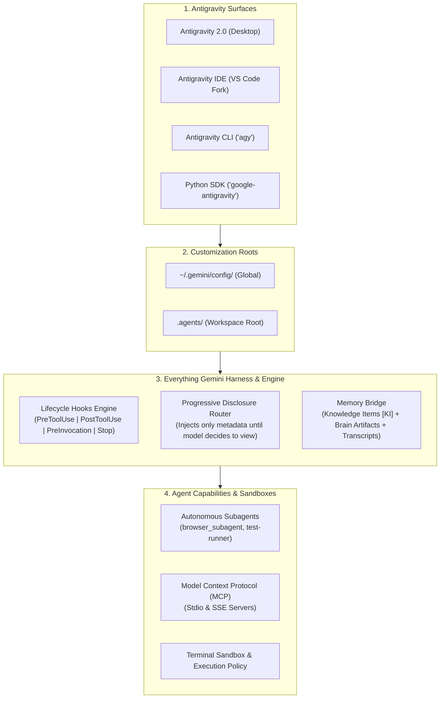

# 🪐 Everything Gemini (everything-gemini)

<div align="center">


[](https://salmandev.github.io/everything-gemini/)
[](https://www.npmjs.com/package/everything-gemini)
[](https://github.com/salmandev/everything-gemini/actions/workflows/ci.yml)
[](https://github.com/salmandev/everything-gemini/actions/workflows/ci.yml)
[](https://github.com/salmandev/everything-gemini)
[](LICENSE)
[](https://antigravity.google)
[](https://github.com/salmandev/everything-gemini)
[](CONTRIBUTING.md)

**The open-source agent harness, multi-agent orchestrator, and performance ecosystem for Google Gemini & Antigravity.**

[Live Interactive Showcase](https://salmandev.github.io/everything-gemini/) • [Quickstart](#-quickstart) • [What is everything-gemini?](#-what-is-everything-gemini) • [Architecture](#-architecture--internals) • [Customization Catalog](#-customization-catalog) • [Surfaces Guide](#-the-4-antigravity-surfaces) • [Contributing](CONTRIBUTING.md)

</div>

---

## ⚡ What is Everything Gemini?

**Google Antigravity** is Google’s state-of-the-art AI-first coding platform, powered by Gemini models, an event-driven execution loop (Cortex), progressive disclosure, multi-surface orchestration (Desktop 2.0, VS Code-based IDE, `agy` CLI, and Python SDK), and localized Knowledge Items (KI).

Out of the box, Antigravity is a formidable pair programmer. But without structured harnesses, agents can suffer from:
- **Context bloat**: Loading massive guidelines into every prompt turn, eroding the model's reasoning window.
- **Unchecked execution risks**: Accidentally running destructive terminal commands or pushing unfinished code.
- **Premature stops**: Quitting multi-step tasks before tests pass or edge cases are verified.
- **Amnesia between sessions**: Forgetting architectural lessons learned yesterday.

**Everything Gemini (`everything-gemini`)** solves this. It provides a battle-tested harness system consisting of:
1. 🛡️ **Safety Shield & Lifecycle Hooks (`hooks.json`)**: Deterministic gating for destructive commands, auto-lint formatters, and stop-guard verifiers.
2. 🧠 **Progressive Disclosure Skills (`skills/`)**: On-demand procedural playbooks that load *only* when needed, saving up to **85% in token overhead**.
3. 📏 **Hierarchical Rules (`GEMINI.md` / `AGENTS.md`)**: Context-aware coding standards, zero-hallucination protocols, and clean-architecture rules.
4. 🔌 **Plug-and-Play Plugins (`plugins/`)**: Domain bundles for Fullstack Web, Python AI, DevOps, and Security.
5. 🌐 **Curated MCP Servers (`mcp/`)**: Production blueprints for Persistent Semantic Memory (`@modelcontextprotocol/server-memory`), High-Performance Cache (`@modelcontextprotocol/server-redis`), Container Engine (`@modelcontextprotocol/server-docker`), Real-Time OLAP (`@modelcontextprotocol/server-clickhouse`), Web Fetch (`server-fetch`), GitHub, PostgreSQL, and SQLite.
6. 🤖 **Subagent & Browser Automation**: Specialized recipes for autonomous browser subagents with automated WebP recording.

---

## 🚀 Quickstart

### 1. Instant Installation via npx (Zero Setup)

Run this directly in any project directory or terminal:

```bash
npx everything-gemini install
```

### 2. One-Line Interactive Installer

```bash
# macOS / Linux
curl -fsSL https://raw.githubusercontent.com/salmandev/everything-gemini/main/scripts/install.sh | bash
```

```powershell
# Windows (PowerShell)
irm https://raw.githubusercontent.com/salmandev/everything-gemini/main/scripts/install.ps1 | iex
```

### 3. Via Repository Clone
```bash
# Clone the repository
git clone https://github.com/salmandev/everything-gemini.git
cd everything-gemini

# Run the Everything Gemini CLI
./bin/everything-gemini install --profile developer
```

### 🛡️ Instant PHP2Shell Audit (CVE-2026-109618 / CVE-2026-109619)

Perform non-intrusive defensive security audits on public endpoints and private servers without installing anything:

```bash
# Audit any public website or API endpoint
npx everything-gemini phpcheck "https://example.com"

# Audit local server, container, and detect un-restarted PHP-FPM workers in RAM
npx everything-gemini phpcheck --server
```

> Read the full [PHP2Shell Security Advisory & Social Media Launch Kit](docs/LAUNCH_KIT_PHP2SHELL.md) for distribution backport matrices and ready-to-post copy.

### 4. Installation Profiles

| Profile | Target Audience | What Gets Installed |
| :--- | :--- | :--- |
| **`core`** | Minimalists & Speed | Safety-shield hook, TDD skill, repo-onboarding skill, baseline `GEMINI.md`. |
| **`developer`** *(Recommended)* | Daily Software Engineers | Core + 18 Scoped Subagents (`agents/`), Frontier Skills (Superpowers TDD methodology, Darwin prompt evolution, CVE mitigator, Multimodal vision, 2M context caching, Subagent handoff, Security audit), Fullstack & Python AI plugins, Auto-formatter & Goal-verifier hooks. |
| **`full`** | Lead Engineers & Archs | Everything: all 101 progressive skills, 18 scoped subagents, full lifecycle hooks suite (13 hooks), 14 MCP blueprints, all plugins, configs, and templates (The 132-Component Century Milestone). |

### 5. In CI / GitHub Actions Workflows

Automate Everything Gemini skill, subagent, and lifecycle safety hook provisioning directly in your CI pipelines using our official composite action:

```yaml
- name: Setup Everything Gemini
  uses: salmandev/everything-gemini@v1
  with:
    profile: developer # core | developer | full
    global: false      # true for ~/.gemini/config/, false for active workspace .agents/
```

---

## 🏗️ Architecture & Internals

`everything-gemini` is engineered specifically around Google Antigravity's internal execution engine:



### Key Differences: ECC vs. Everything Gemini

> 📖 **Read the Comprehensive Architectural Breakdown**: [Everything Claude Code (ECC) vs. Everything Gemini](docs/ecc-vs-everything-gemini.md)

| Feature | Everything Claude Code (ECC) | Everything Gemini (`everything-gemini`) |
| :--- | :--- | :--- |
| **Target Platform** | Claude Code CLI & harnesses | Antigravity 2.0 Desktop, IDE, `agy` CLI, Python SDK |
| **Model Engine** | Claude 3.5 / 3.7 Sonnet | Gemini 3.8 / 1.5 Flash & Pro |
| **Context Protocol** | Direct markdown prompts | **Progressive Disclosure** (Metadata injected first, bodies lazy-loaded) |
| **Context Window & Caching** | 200k tokens, ephemeral | **1M-2M+ tokens with Native Prefix Context Caching (~75% cost savings)** |
| **Memory System** | Flat markdown files | **Knowledge Items (KI)** + **Adaptive Learned Instincts** |
| **UI & Visual Multimodality** | Standard text output | **Native `browser_subagent` + WebP Screen Video Recording + Vision** |
| **Subagents Fleet** | Manual sub-prompts | **10 Scoped Subagents (`agents/`) with Formal Handoff Protocol** |
| **Lifecycle Hooks** | Shell scripts | Typed protojson contracts (`PreToolUse`, `PostToolUse`, `PreInvocation`, `PostInvocation`, `Stop`) |
| **Tool Integration** | Claude tool use | **MCP standard (Stdio & SSE)** with auto-discovery & namespacing |

---

## 📂 Repository Directory Layout

```text
everything-gemini/
├── .github/                      # CI/CD workflows & issue templates
├── bin/                          # Zero-dependency harness & scaffolding CLI
├── agents/                       # Scoped subagent fleet (Planner, Reviewer, Release Engineer, etc.)
├── scripts/                      # Automated installers and harness validators
├── plugins/                      # Reusable modular plugins (web-fullstack, python-ai, security)
├── skills/                       # 76 Progressive disclosure skills (74 core + 2 plugins)
├── rules/                        # Contextual guidelines & standards
├── hooks/                        # Event-driven lifecycle hooks (GeminiShield, Auto-lint, ThinkingBudget)
├── mcp/                          # Production-ready MCP server blueprints
├── docs/                         # The Comprehensive Antigravity Bible
└── templates/                    # Starter templates (minimal, recommended, full-power)
```

---

## 🧰 Customization Catalog

### 🤖 Scoped Sub-Agents (`agents/`)

Everything Gemini provides specialized subagent specifications designed for Antigravity's native `invoke_subagent` delegation and Python SDK orchestration:

| Subagent | Role | Focus Area |
| :--- | :--- | :--- |
| **[`planner`](agents/planner.md)** | Strategic Planner | Dependency mapping, impact radius analysis, phased checklists. |
| **[`code-reviewer`](agents/code-reviewer.md)** | Quality Auditor | Edge case verification, type safety, regression prevention, minimal diffs. |
| **[`build-repair`](agents/build-repair.md)** | Build Triage Specialist | Compiler error diagnosis, test failure auto-repair, surgical fixes. |
| **[`browser-qa`](agents/browser-qa.md)** | Automated Visual QA | Native browser testing with automated WebP recording into artifacts. |
| **[`security-auditor`](agents/security-auditor.md)** | Security Auditor | Credential scanning, OWASP Top 10, dependency audit, permission gates. |
| **[`architect`](agents/architect.md)** | Systems Architect | C4 Mermaid blueprints, sequence diagrams, and formal ADR records. |
| **[`database-migrator`](agents/database-migrator.md)** | Database Schema Specialist | Zero-downtime expand/contract SQL migrations, lock analysis, and rollbacks. |
| **[`performance-tuner`](agents/performance-tuner.md)** | Latency & Profiling Expert | CPU/memory flamegraphs, database execution plans, and N+1 waterfalls. |
| **[`documentation-writer`](agents/documentation-writer.md)** | Technical Documentation Specialist | API specifications, ADR governance, changelogs, and clickable file:// link fidelity. |
| **[`release-engineer`](agents/release-engineer.md)** | Release Automation Gatekeeper | Semantic Versioning, build artifact checksums, git release tagging, and canary rollouts. |
| **[`incident-responder`](agents/incident-responder.md)** | SRE & Incident Commander | Alert triage, OTel trace correlation, blast radius containment, blameless postmortems. |
| **[`platform-engineer`](agents/platform-engineer.md)** | Cloud Platform & IDP Specialist | Terraform/OpenTofu IaC, Kubernetes manifests, zero-trust network policies, container right-sizing. |
| **[`mlops-engineer`](agents/mlops-engineer.md)** | MLOps & LLMOps Specialist | Model serving (Triton/vLLM), vector clustering (ChromaDB/Milvus), prefix context caching, KEDA autoscaling. |
| **[`swarm-coordinator`](agents/swarm-coordinator.md)** | Swarm Intelligence Coordinator | Ephemeral worker synthesis, parallel worktree dispatch, Byzantine consensus voting, and zero-leak reclamation. |
| **[`resilience-engineer`](agents/resilience-engineer.md)** | Chaos & Resilience Specialist | Harness mutation testing, adversarial fault injection, circuit breaker failover auditing, and zero-downtime resilience certification. |
| **[`cross-repo-orchestrator`](agents/cross-repo-orchestrator.md)** | Cross-Repository Swarm Architect | Multi-repository dependency synchronization, cross-boundary 2PC commit gating, and contract schema alignment. |
| **[`darwin-prompt-engineer`](agents/darwin-prompt-engineer.md)** | Darwinian Genetic Prompt Architect | Multi-generation prompt tournament selection, adversarial fuzzing, and Pareto efficiency optimization. |
| **[`cve-mitigator`](agents/cve-mitigator.md)** | Zero-Day CVE Remediation Specialist | 4-layer defense-in-depth virtual patching, kernel ASLR verification, container least-privilege, and memory inode auditing. |

### 1. Skills (`skills/`)
Skills in Antigravity are lazy-loaded runbooks. Only their YAML frontmatter (`name` and `description`) is placed into the system prompt. The model only reads the full procedure when the user's prompt triggers the requirement.

- **[`superpowers`](skills/superpowers/SKILL.md)**: Enforces disciplined agentic software development methodology (inspired by Jesse Vincent's `obra/superpowers`). Conducts interactive specification gathering, creates step-by-step red-green TDD implementation plans, orchestrates scoped subagents, and ensures zero-drift verification before committing changes.
- **[`autonomous-incident-healer`](skills/autonomous-incident-healer/SKILL.md)**: Autonomously detects production incident anomalies, executes deterministic self-healing runbooks, triggers automated canary traffic draining or rollback, and compiles blameless root-cause analysis (RCA).
- **[`spanner-distributed-locks`](skills/spanner-distributed-locks/SKILL.md)**: Implements enterprise distributed locks, leader election, and mutual exclusion leases on Google Cloud Spanner using TrueTime and conditional mutations.
- **[`gemini-live-audio-transcriber`](skills/gemini-live-audio-transcriber/SKILL.md)**: Streams bidirectional low-latency audio via WebSocket/WebRTC to the Gemini Live API, handling Opus framing, Voice Activity Detection (VAD), live turn interruptions, and real-time pair-programming transcription.
- **[`multi-modal-screen-actor`](skills/multi-modal-screen-actor/SKILL.md)**: Executes autonomous GUI perception and mouse/keyboard action loops for Desktop 2.0, normalizing screen coordinates (0-1000), grounding UI elements, and verifying visual side-effects.
- **[`spanner-vector-search`](skills/spanner-vector-search/SKILL.md)**: Executes high-performance Approximate Nearest Neighbor (ANN) vector search and hybrid Graph RAG queries on Google Cloud Spanner using ScaNN indexes and COSINE_DISTANCE functions.
- **[`cloud-deploy-canary`](skills/cloud-deploy-canary/SKILL.md)**: Orchestrates automated progressive delivery, canary traffic splitting, and metric-based rollback gates using Google Cloud Deploy for Cloud Run and GKE.
- **[`alloydb-omni-vector`](skills/alloydb-omni-vector/SKILL.md)**: Configures AlloyDB Omni with pgvector and the Columnar Engine for ultra-fast HNSW vector similarity search and analytical queries.
- **[`zero-trust-workload-identity`](skills/zero-trust-workload-identity/SKILL.md)**: Configures GCP Workload Identity Federation, SPIFFE/SPIRE cryptographic attestation, and short-lived STS tokens for multi-cloud autonomous agents without static service account keys.
- **[`cve-remediation-orchestrator`](skills/cve-remediation-orchestrator/SKILL.md)**: Defense-in-depth CVE mitigation, virtual patching, kernel ASLR hardening, and worker memory verification.
- **[`php2shell-version-auditor`](skills/php2shell-version-auditor/SKILL.md)**: Enterprise vulnerability auditor and fleet triage runbook for PHP2Shell (CVE-2026-109618 & CVE-2026-109619).
- **[`phpcheck-url`](skills/phpcheck-url/SKILL.md)**: Fast non-intrusive remote HTTP banner and advertised PHP version auditor.
- **[`phpcheck-server`](skills/phpcheck-server/SKILL.md)**: Server-side OS package backport auditor and un-restarted worker memory detector.
- **[`adversarial-fuzz-generator`](skills/adversarial-fuzz-generator/SKILL.md)**: Synthesizes property-based and adversarial test suites using hypothesis-style fuzzing to mathematically verify codebase and prompt modifications.
- **[`genetic-prompt-cross-pollinator`](skills/genetic-prompt-cross-pollinator/SKILL.md)**: Cross-pollinates winning agent prompt traits and subagent contracts using genetic crossover operators and Pareto selection.
- **[`instinct-distillation-compiler`](skills/instinct-distillation-compiler/SKILL.md)**: Compiles runtime edge cases and failure modes into persistent, deterministic learned rules in `.agents/hooks/learned-instincts/`.
- **[`gemini-live-screen-vision`](skills/gemini-live-screen-vision/SKILL.md)**: Streams active IDE screens and browser DOM states to Gemini Live, analyzing real-time repaints, terminal error bursts, and layout regressions.
- **[`cross-repo-swarm-sync`](skills/cross-repo-swarm-sync/SKILL.md)**: Coordinates distributed multi-repository agent swarm synchronization, atomic dependency alignment, and cross-boundary git branch PR orchestration via Google Cloud Pub/Sub and Cloud Run.
- **[`ebpf-microvm-sandbox`](skills/ebpf-microvm-sandbox/SKILL.md)**: Enforces rootless ephemeral Micro-VM isolation (Firecracker/gVisor), Linux Landlock filesystem jails, and Cilium eBPF network filtering for zero-trust speculative tool and code execution.
- **[`context-distillation-compressor`](skills/context-distillation-compressor/SKILL.md)**: Performs AST-guided semantic context distillation, lossy-to-lossless prompt compaction, and memory pruning to prevent context bloat and token degradation in long agent trajectories.
- **[`speculative-decoding-orchestrator`](skills/speculative-decoding-orchestrator/SKILL.md)**: Orchestrates dual-model speculative decoding routing draft tokens via Gemini 2.0 Flash and parallel verification via Gemini 3.8 Extended Thinking for 3.5x inference acceleration.
- **[`webrtc-agent-gateway`](skills/webrtc-agent-gateway/SKILL.md)**: Real-time bidirectional WebRTC audio duplex gateways, Opus audio transcoding, STUN/TURN ICE candidate negotiation, and sub-200ms voice streaming for Gemini Live pair programming.
- **[`opentelemetry-agent-observability`](skills/opentelemetry-agent-observability/SKILL.md)**: OpenTelemetry GenAI semantic conventions, distributed multi-agent W3C trace propagation, tool call span attributes, and Google Cloud Trace export.
- **[`harness3-mutation-testing`](skills/harness3-mutation-testing/SKILL.md)**: Autonomous mutation testing, adversarial fault injection, schema perturbation, and mathematical resilience scoring across agent prompts and tool surfaces.
- **[`envoy-ai-gateway`](skills/envoy-ai-gateway/SKILL.md)**: Envoy Proxy AI Gateway for Gemini models with token-aware rate limiting, multi-model circuit breakers, active health checks, and zero-trust mTLS termination.
- **[`ephemeral-swarm-orchestrator`](skills/ephemeral-swarm-orchestrator/SKILL.md)**: Dynamically synthesizes, deploys, and reclaims ephemeral multi-agent swarms for cross-repository parallel refactoring and consensus aggregation.
- **[`dynamic-thinking-allocation`](skills/dynamic-thinking-allocation/SKILL.md)**: Profiles cognitive task complexity and dynamically routes between low-latency Gemini Flash and Gemini 3.8 Extended Thinking reasoning budgets.
- **[`ebpf-sandbox-enforcer`](skills/ebpf-sandbox-enforcer/SKILL.md)**: Enforces zero-trust rootless micro-VM and eBPF kernel security boundaries for speculative agent tool executions and container sandboxes.
- **[`quantum-safe-cryptography`](skills/quantum-safe-cryptography/SKILL.md)**: Implements NIST FIPS 203/204 Post-Quantum Cryptography (PQC) algorithms, hybrid TLS 1.3 key exchange, and quantum-resistant API authentication.
- **[`gemini-live-multimodal`](skills/gemini-live-multimodal/SKILL.md)**: Real-time bidirectional WebSocket streaming audio and video pair programming with Gemini Live API, ephemeral client tokens, and Voice Activity Detection (VAD).
- **[`cost-oracle-finops`](skills/cost-oracle-finops/SKILL.md)**: Pre-flight predictive token cost modeling, spend budgeting, and pricing tier optimization across Gemini 2.0 Flash, Pro, and Gemini 3.8 extended reasoning agents.
- **[`vertex-ai-feature-store`](skills/vertex-ai-feature-store/SKILL.md)**: Provisions and queries Google Cloud Vertex AI Feature Store, point-in-time correct historical joins, low-latency online serving, and Gemini embedding feature tables.
- **[`spanner-change-streams`](skills/spanner-change-streams/SKILL.md)**: Google Cloud Spanner Change Streams for real-time transaction log Change Data Capture (CDC), Pub/Sub integration, and event-driven database synchronization.
- **[`bigquery-vector-search`](skills/bigquery-vector-search/SKILL.md)**: Native BigQuery vector search, `VECTOR_SEARCH` SQL statements, `ML.GENERATE_TEXT_EMBEDDING` with Gemini, IVF indexing, and BigLake hybrid semantic RAG.
- **[`cloud-run-agents`](skills/cloud-run-agents/SKILL.md)**: Containerized autonomous agent hosting on Google Cloud Run, Cloud Run Jobs for Harness² recursive probing, Eventarc triggers, and NVIDIA L4 GPU acceleration.
- **[`pubsub-event-mesh`](skills/pubsub-event-mesh/SKILL.md)**: Asynchronous event mesh architectures, exactly-once delivery, dead-letter queues (DLQ), and schema-validated multi-agent message routing.
- **[`spanner-graph-rag`](skills/spanner-graph-rag/SKILL.md)**: Distributed Spanner Graph schemas, ISO GQL queries, knowledge graph traversal, and hybrid graph-vector RAG pipelines for Gemini agents.
- **[`context-warmer`](skills/context-warmer/SKILL.md)**: Automated workspace repository analysis, Knowledge Item clustering, and pre-warming prefix context caches before subagent execution.
- **[`harness2-recursive-optimization`](skills/harness2-recursive-optimization/SKILL.md)**: Google Research Harness² framework (*Harness²: Recursive Agent Harnessing for an Open World*, arXiv:2610.14224), 8-surface architecture, test-time Propose-Probe-Compose recursive loops, and continual harness learning.
- **[`google-flow-orchestrator`](skills/google-flow-orchestrator/SKILL.md)**: Google Agentic Flow state machine orchestration, cyclic multi-agent graph execution, conditional state routing, and human-in-the-loop pauses.
- **[`dataproc-spark-analytics`](skills/dataproc-spark-analytics/SKILL.md)**: Google Cloud Dataproc Serverless Spark, PySpark batch pipelines, Gemini embedding UDFs, BigLake vector indexing, and large-scale probe score verification.
- **[`keda-event-autoscaling`](skills/keda-event-autoscaling/SKILL.md)**: Kubernetes Event-driven Autoscaling (KEDA), ScaledObjects/Jobs, Kafka/Redis/Prometheus triggers, scale-to-zero.
- **[`chromadb-vector-store`](skills/chromadb-vector-store/SKILL.md)**: Persistent vector storage, Gemini embeddings, collection partitioning, metadata filtering, and semantic similarity search.
- **[`opa-gatekeeper-policy`](skills/opa-gatekeeper-policy/SKILL.md)**: Open Policy Agent (OPA) Gatekeeper ConstraintTemplates and Rego admission policies for Kubernetes governance.
- **[`triton-inference-server`](skills/triton-inference-server/SKILL.md)**: NVIDIA Triton Inference Server multi-model serving, dynamic batching, GPU acceleration, TensorRT-LLM, and vLLM backends.
- **[`milvus-vector-clustering`](skills/milvus-vector-clustering/SKILL.md)**: Enterprise Milvus vector clustering, HNSW/IVF-PQ indexing, hybrid dense-sparse search, and partition keys.
- **[`cloudflare-r2-object-storage`](skills/cloudflare-r2-object-storage/SKILL.md)**: Zero-egress fee object storage, S3-compatible APIs, pre-signed upload URLs, and Workers edge CDN.
- **[`vault-secrets-management`](skills/vault-secrets-management/SKILL.md)**: HashiCorp Vault enterprise secrets orchestration, AppRole authentication, dynamic ephemeral DB credentials, and PKI mTLS.
- **[`distributed-rate-limiting`](skills/distributed-rate-limiting/SKILL.md)**: High-throughput distributed rate limiting using Redis sliding window logs, token buckets, and RFC 6585 compliance.
- **[`vllm-inference`](skills/vllm-inference/SKILL.md)**: High-throughput LLM serving, PagedAttention KV cache, continuous batching, and tensor parallelism.
- **[`debezium-cdc`](skills/debezium-cdc/SKILL.md)**: Change Data Capture (CDC) streaming, PostgreSQL logical decoding, Kafka Connect, and outbox patterns.
- **[`cilium-ebpf-networking`](skills/cilium-ebpf-networking/SKILL.md)**: Cloud-native eBPF networking, transparent mTLS, L7 CiliumNetworkPolicies, and Hubble observability.
- **[`litellm-proxy-gateway`](skills/litellm-proxy-gateway/SKILL.md)**: Enterprise LLM proxy gateway, multi-provider routing (Gemini, Claude, OpenAI), budget controls, and fallback cascades.
- **[`langgraph-orchestrator`](skills/langgraph-orchestrator/SKILL.md)**: Stateful multi-agent graphs, cyclic execution loops, persistent checkpointers, and human-in-the-loop pauses.
- **[`playwright-visual-regression`](skills/playwright-visual-regression/SKILL.md)**: Automated visual regression testing, pixelmatch snapshot diffing, cross-browser viewports, and containerized stability.
- **[`open-telemetry-tracing`](skills/open-telemetry-tracing/SKILL.md)**: Distributed tracing, OTLP exporters, W3C traceparent context propagation, and metric correlation.
- **[`argo-workflows`](skills/argo-workflows/SKILL.md)**: Kubernetes-native DAG workflows, artifact passing, container steps, retry strategies, and CronWorkflows.
- **[`gemini-multimodal`](skills/gemini-multimodal/SKILL.md)**: Native visual reasoning over mockups, diagrams, and automated WebP browser recordings.
- **[`context-caching`](skills/context-caching/SKILL.md)**: 1M-2M token context optimization, static prefix caching, and repository indexing.
- **[`gemini-grounding`](skills/gemini-grounding/SKILL.md)**: Real-time Google Search grounding, live documentation retrieval, and fact-checking.
- **[`rag-architect`](skills/rag-architect/SKILL.md)**: RAG pipeline design, AST semantic chunking, hybrid vector-keyword retrieval, and Gemini re-ranking.
- **[`gemini-function-calling`](skills/gemini-function-calling/SKILL.md)**: Production function declarations, structured JSON output schemas (Pydantic), and parallel tool dispatch.
- **[`ai-first-engineering`](skills/ai-first-engineering/SKILL.md)**: Requirement decomposition, executable acceptance criteria (BDD), and blast-radius containment.
- **[`agent-evals`](skills/agent-evals/SKILL.md)**: Automated evaluation pipelines, LLM-as-a-judge scoring, golden test datasets, and prompt regression testing.
- **[`github-ops`](skills/github-ops/SKILL.md)**: GitHub workflow automation, PR generation, code review triage, and semantic releases with `gh` CLI & GitHub MCP.
- **[`subagent-handoff`](skills/subagent-handoff/SKILL.md)**: Multi-agent task delegation protocol, scoped contexts, and report synthesis.
- **[`api-craftsman`](skills/api-craftsman/SKILL.md)**: REST, OpenAPI 3.1 specifications, gRPC protos, and RFC 7807 error envelopes.
- **[`database-architect`](skills/database-architect/SKILL.md)**: Zero-downtime migrations, concurrent indexing, and ACID schema modeling.
- **[`turborepo-monorepo`](skills/turborepo-monorepo/SKILL.md)**: High-performance monorepo build caching, task pipelines, package boundaries, and Docker pruning.
- **[`dbt-transformation`](skills/dbt-transformation/SKILL.md)**: Modular SQL transformations, Jinja macros, semantic layer models, schema tests, and docs.
- **[`apache-kafka-streams`](skills/apache-kafka-streams/SKILL.md)**: Exactly-once event streaming, stateful window aggregations, consumer group rebalancing, and Schema Registry.
- **[`grpc-connect-rpc`](skills/grpc-connect-rpc/SKILL.md)**: Lightweight, browser-compatible gRPC and Protocol Buffers with Connect-ES / Connect-Go and HTTP/2-3 streaming.
- **[`duckdb-local-olap`](skills/duckdb-local-olap/SKILL.md)**: Embedded in-process SQL analytics, direct S3/Parquet querying, and zero-copy Arrow integration.
- **[`nats-jetstream`](skills/nats-jetstream/SKILL.md)**: Ultra-low latency event streaming, message deduplication, durable consumer groups, and KV buckets.
- **[`axum-web-service`](skills/axum-web-service/SKILL.md)**: Production Rust web APIs using Axum, Tokio async runtime, Tower middlewares, and SQLx connection pools.
- **[`clickhouse-analytics`](skills/clickhouse-analytics/SKILL.md)**: High-throughput OLAP schemas, MergeTree engines, Kafka ingestion, and vector search.
- **[`temporal-workflows`](skills/temporal-workflows/SKILL.md)**: Resilient distributed workflows, retry policies, async activities, and saga compensations.
- **[`trpc-react-query`](skills/trpc-react-query/SKILL.md)**: End-to-end type safety, tRPC v11 routers, and TanStack React Query v5 optimistic UI.
- **[`wasm-rust-optimizer`](skills/wasm-rust-optimizer/SKILL.md)**: High-throughput WebAssembly modules compiled from Rust with zero-copy memory buffers.
- **[`fastapi-production`](skills/fastapi-production/SKILL.md)**: Production async FastAPI architecture, Pydantic v2 schemas, lifespan handlers, and health probes.
- **[`redis-cache-patterns`](skills/redis-cache-patterns/SKILL.md)**: Enterprise Redis caching strategies, distributed locking with atomic Lua, and sliding-window rate limiting.
- **[`svelte-kit-architect`](skills/svelte-kit-architect/SKILL.md)**: Modern SvelteKit apps with Svelte 5 runes ($state, $derived, $effect), SSR/prerender, and form actions.
- **[`fullstack-nextjs`](skills/fullstack-nextjs/SKILL.md)**: Next.js App Router, React Server Components (RSC), hydration error diagnosis, and Server Actions.
- **[`graphql-architect`](skills/graphql-architect/SKILL.md)**: Schema-first GraphQL APIs, DataLoader N+1 query batching, and Relay cursor pagination.
- **[`supabase-architect`](skills/supabase-architect/SKILL.md)**: Row Level Security (RLS) policies, pgvector embeddings, and edge function workflows.
- **[`cloudflare-workers`](skills/cloudflare-workers/SKILL.md)**: Serverless edge functions, Wrangler v3, D1 SQL, and KV low-latency storage.
- **[`docker-compose-orchestrator`](skills/docker-compose-orchestrator/SKILL.md)**: Multi-container local environments (Postgres + pgvector, Redis) with healthchecks.
- **[`kubernetes-operator`](skills/kubernetes-operator/SKILL.md)**: Production k8s manifests, HPA autoscaling, zero-downtime rolling updates, and health probes.
- **[`stripe-integration`](skills/stripe-integration/SKILL.md)**: Webhook signature verification, idempotent payments, and customer portal session flows.
- **[`devops-pipeline`](skills/devops-pipeline/SKILL.md)**: Multi-stage Dockerfiles and caching GitHub Actions CI/CD workflows.
- **[`root-cause-debugger`](skills/root-cause-debugger/SKILL.md)**: Regression diagnosis using binary search (`git bisect`) and minimal reproduction harnesses.
- **[`tdd-workflow`](skills/tdd-workflow/SKILL.md)**: Red-Green-Refactor loop with automated test runners.
- **[`browser-qa-tester`](skills/browser-qa-tester/SKILL.md)**: Autonomous browser UI testing with WebP capture into artifacts.
- **[`architecture-designer`](skills/architecture-designer/SKILL.md)**: System architecture, C4 & Mermaid blueprints.
- **[`repo-onboarding`](skills/repo-onboarding/SKILL.md)**: Fast codebase indexing into Knowledge Items (KI).
- **[`git-craftsman`](skills/git-craftsman/SKILL.md)**: Enforces conventional commits, atomic diffs, and clean PR descriptions.
- **[`security-audit`](skills/security-audit/SKILL.md)**: Scans for credentials in commit history and audits dependency risks.
- **[`php2shell-version-auditor`](skills/php2shell-version-auditor/SKILL.md)**: Enterprise vulnerability auditor and fleet triage runbook for PHP2Shell (CVE-2026-109618 & CVE-2026-109619).
- **[`cve-remediation-orchestrator`](skills/cve-remediation-orchestrator/SKILL.md)**: Defense-in-depth CVE mitigation, virtual patching, kernel ASLR hardening, and worker memory verification.
- **[`phpcheck-url`](skills/phpcheck-url/SKILL.md)**: Fast non-intrusive remote HTTP banner and advertised PHP version auditor.
- **[`phpcheck-server`](skills/phpcheck-server/SKILL.md)**: Server-side OS package backport auditor and un-restarted worker memory detector.
- **[`performance-profiler`](skills/performance-profiler/SKILL.md)**: Identifies CPU/memory bottlenecks, analyzes database queries, and critical paths.
- **[`continuous-learning`](skills/continuous-learning/SKILL.md)**: Codifies corrections and developer feedback into enduring Knowledge Items.
- **[`antigravity-sdk-orchestrator`](plugins/python-ai/skills/antigravity-sdk-orchestrator/SKILL.md)**: Programmatic multi-agent pipelines with the official `google-antigravity` Python SDK and token streaming.
- **[`responsive-design`](plugins/web-fullstack/skills/responsive-design/SKILL.md)**: Fluid typography, mobile-first flex/grid layouts, media queries, and cross-browser accessibility.

### 2. Lifecycle Hooks (`hooks/`)
Hooks run shell scripts at critical lifecycle events with typed JSON contracts on `stdin`/`stdout`:

- **[`gemini-shield`](hooks/gemini-shield/hooks.json) (`PreToolUse`)**: Deterministic safety firewall intercepting `run_command` and denying catastrophic operations like `rm -rf /`, `mkfs`, or `git push --force origin main`.
- **[`safety-shield`](hooks/safety-shield/hooks.json) (`PreToolUse`)**: Intercepts `run_command` and inspects `CommandLine` against strict security guidelines before shell execution.
- **[`secret-scrubber`](hooks/secret-scrubber/hooks.json) (`PreToolUse`)**: Intercepts file write operations to block hardcoded API keys and private credentials before they reach disk.
- **[`auto-lint-formatter`](hooks/auto-lint-formatter/hooks.json) (`PostToolUse`)**: Triggered after file modifications. Runs your project's linter/formatter (`prettier`, `black`, `ruff`, `gofmt`) automatically so code is always clean.
- **[`goal-verifier`](hooks/goal-verifier/hooks.json) (`Stop`)**: Intercepts the agent's attempt to finish. If test suites are failing or background tasks are unfinished, it returns `{"decision": "continue", "reason": "Tests are still failing. Fix them before stopping."}`.
- **[`ephemeral-context`](hooks/ephemeral-context/hooks.json) (`PreInvocation`)**: Injects transient warnings or guidelines before each model reasoning step without cluttering persistent conversation history.
- **[`learned-instincts`](hooks/learned-instincts/hooks.json)**: Session learning hook that records developer corrections and feedback into persistent instincts.
- **[`budget-guard`](hooks/budget-guard/hooks.json) (`PreToolUse`)**: Intercepts tool execution to enforce hard USD spend caps (`MAX_USD_BUDGET`), tracking step-by-step token expenditure and denying execution when financial limits are met.
- **[`human-gate`](hooks/human-gate/hooks.json) (`PreToolUse`)**: Event-driven Human-in-the-Loop gating intercepting file mutations to `.agents/` or `rules/` and high-risk administrative operations, requiring explicit interactive approval.
- **[`thinking-budget`](hooks/thinking-budget/hooks.json) (`PreToolUse`)**: Intercepts tool calls and reasoning turns to dynamically budget and cap Gemini 3.8 extended reasoning token runaways.
- **[`drift-detector`](hooks/drift-detector/hooks.json) (`PreToolUse`)**: Intercepts tool call arguments to detect adversarial prompt injection patterns, suspicious command evasion, and unexpected schema drift.
- **[`context-compactor`](hooks/context-compactor/hooks.json) (`PreToolUse`)**: Evaluates tool input payload sizes and trajectory context pressure to recommend AST pruning or compacting oversized buffers.
- **[`zero-trust-gate`](hooks/zero-trust-gate/hooks.json) (`PreToolUse`)**: Deterministic container confinement sentinel blocking privileged flags (`--privileged`), dangerous capabilities (`CAP_SYS_ADMIN`), and unsafe docker socket mounts.

### 3. Rules Hierarchy (`rules/`)
Antigravity automatically discovers rules by walking up from the current file's directory to the repository root:
- **[`rules/common/GEMINI.md`](rules/common/GEMINI.md)**: Foundational instructions for precision, minimal changes, and strict verification.
- **[`rules/common/AGENTS.md`](rules/common/AGENTS.md)**: Multi-agent interaction protocols, dogfooding guidelines, and progressive disclosure discipline.
- **[`rules/languages/typescript.md`](rules/languages/typescript.md)**: Strict TypeScript, Zod validations, no `any`, modern ESM.
- **[`rules/languages/python.md`](rules/languages/python.md)**: Python 3.12+, type hints, Pydantic v2, Ruff formatting.
- **[`rules/languages/golang.md`](rules/languages/golang.md)**: Idiomatic Go guidelines, table-driven unit tests, and structured logging.
- **[`rules/paradigms/security-hardened.md`](rules/paradigms/security-hardened.md)**: Defense-in-depth, zero-trust file access, credential hygiene.
- **[`rules/paradigms/tdd.md`](rules/paradigms/tdd.md)**: Enforces strict Red-Green-Refactor test cycle before writing production code.

---

## 🖥️ The 4 Antigravity Surfaces

Antigravity operates across four interconnected surfaces. `everything-gemini` supports all of them seamlessly:

```
+-----------------------------------------------------------------------------------+
|                                 GOOGLE ANTIGRAVITY                                |
+-------------------------+-------------------------+-------------------------------+
|  1. Antigravity 2.0     |  2. Antigravity IDE     |  3. Antigravity CLI ('agy')   |
|  (Desktop App)          |  (VS Code Fork)         |  (Terminal & Headless)        |
|  - Unified Left Sidebar |  - Antigravity Tab      |  - Fast interactive TUI       |
|  - Chat Canvas          |    (Autocomplete/Super) |  - Headless scripting         |
|  - Auxiliary Panes      |  - Inline (Cmd+I)       |  - Automated CI pipes         |
|    (Subagents, Artifacts|  - Code Lenses & Diffs  |  - Settings JSON              |
+-------------------------+-------------------------+-------------------------------+
|                      4. Python SDK ('google-antigravity')                         |
|  - Programmatic leasing  - Streaming thoughts deltas  - Custom tool wiring        |
+-----------------------------------------------------------------------------------+
```

1. **Antigravity 2.0 (Desktop Application)**: The flagship Electron desktop application. Supports scheduled tasks (cron/timers), background process monitoring, visual artifact viewers, and slash commands.
2. **Antigravity IDE**: Standalone AI-first integrated editor based on VS Code. Features **Antigravity Tab** (next-intent prediction), **Inline Edits (`Cmd+I`)**, **Code Lenses**, and **Diagnostic Auto-Fix**.
3. **Antigravity CLI (`agy`)**: High-speed terminal TUI for keyboard-driven workflows and headless script automation.
4. **Antigravity Python SDK (`google-antigravity`)**: Public Python SDK allowing developers to build custom agents, stream reasoning tokens (`response.thoughts`), and wire custom tools.

---

## 🪄 Slash Commands Playbook

Antigravity provides built-in slash commands in chat that activate specialized cognitive modes:

| Command | Purpose | How Everything Gemini Enhances It |
| :--- | :--- | :--- |
| **`/goal <task>`** | Long-running autonomous mode | Pairs with Everything Gemini's **Goal Verifier Hook** to prevent premature termination until test suites pass. |
| **`/plan <task>`** | Step-by-step implementation blueprint | Enforces architectural review, risk assessment, and mermaid diagrams before code edits. |
| **`/grill-me`** | Interactive design interview | Asks hard architectural and trade-off questions to resolve ambiguities before implementing. |
| **`/learn`** | Persist feedback across sessions | Automatically indexes insights into a permanent Knowledge Item (`<appDataDir>/knowledge`). |
| **`/schedule`** | One-shot or recurring background tasks | Sets up cron monitors or health-check agents with reactive wakeup. |

---

## 📊 Token Efficiency & Benchmark

Traditional agent harnesses dump dozens of prompt files into the system prompt on every single turn. Antigravity's **Progressive Disclosure** paired with Everything Gemini avoids this:

```
[Traditional Setup]
System Prompt: Base Instructions + All 30 Skills (Full Text) + All Rules = ~48,000 Tokens / turn

[Everything Gemini on Antigravity]
System Prompt: Base Instructions + 30 Skill Summaries (YAML) + Directory Rules = ~3,400 Tokens / turn
Skill Body: Loaded on-demand ONLY when invoked = ~1,500 Tokens (one-time)
Savings: > 85% Token Reduction & 3x Faster First-Token Latency!
```

Run the built-in diagnostic benchmark across all 132 ecosystem components (101 progressive skills):
```bash
./bin/everything-gemini test-all
```

---

## 🛠️ Usage & CLI Reference

The zero-dependency `everything-gemini` CLI manages your configurations effortlessly:

```bash
# Verify your installation and check for conflicts
./bin/everything-gemini doctor

# Inspect active workspace status dashboard (installed skills, subagents, hooks)
./bin/everything-gemini status
./bin/everything-gemini status --global
./bin/everything-gemini status --json

# Compare installed workspace components against master catalog
./bin/everything-gemini diff

# Export installed configuration bundle into a portable JSON profile
./bin/everything-gemini export
./bin/everything-gemini export --output my-profile.json

# Import portable configuration bundle into workspace
./bin/everything-gemini import my-profile.json
./bin/everything-gemini import my-profile.json --dry-run
./bin/everything-gemini import my-profile.json --workspace ./my-project

# Package offline distribution bundle for air-gapped environments or CI/CD
./bin/everything-gemini bundle
./bin/everything-gemini bundle --output ./offline-bundle
./bin/everything-gemini bundle --dry-run
./bin/everything-gemini bundle --json

# Update installed ecosystem components in-place to latest catalog versions
./bin/everything-gemini update
./bin/everything-gemini update --global
./bin/everything-gemini update --dry-run

# Preview an installation without modifying disk
./bin/everything-gemini install --profile developer --dry-run

# Install a specific profile into the current workspace (.agents/)
./bin/everything-gemini install --profile developer

# Install globally for all projects (~/.gemini/config/)
./bin/everything-gemini install --global --profile core

# List all available skills, rules, hooks, and plugins
./bin/everything-gemini list

# Initialize everything-gemini in current workspace
./bin/everything-gemini init

# Add a specific skill to your active workspace
./bin/everything-gemini add skill tdd-workflow

# Remove a skill from your active workspace
./bin/everything-gemini remove skill tdd-workflow

# Add or remove lifecycle safety hooks
./bin/everything-gemini add hook safety-shield
./bin/everything-gemini remove hook safety-shield

# Add a specific plugin
./bin/everything-gemini add plugin web-fullstack

# Search components across skills, subagents, hooks, and MCP blueprints
./bin/everything-gemini search kafka
./bin/everything-gemini search dbt --json

# Run comprehensive ecosystem audit across frontmatter, contracts, hooks, and links
./bin/everything-gemini audit
./bin/everything-gemini audit --json

# Benchmark and validate all 84 skills, 16 subagents, and 12 hooks (112 components)
./bin/everything-gemini test-all
./bin/everything-gemini benchmark --json

# Pre-flight predictive token cost modeling & FinOps spend budgeting across models
./bin/everything-gemini estimate
./bin/everything-gemini estimate --model flash --turns 5 --max-usd 5.00
./bin/everything-gemini estimate --json

# Run Harness³ Autonomous Darwinian genetic self-evolution & benchmark
./bin/everything-gemini harness3 auto-bench --generations 3 --max-usd 2.50
./bin/everything-gemini harness3 --dry-run
./bin/everything-gemini harness3 --json

# Launch interactive visual mission control web dashboard
./bin/everything-gemini ui --port 4200
./bin/everything-gemini ui --dry-run
./bin/everything-gemini ui --json

# Spawn dynamic ephemeral micro-agent swarms with Byzantine consensus
./bin/everything-gemini swarm spawn "refactor auth middleware to zero-trust mTLS" --workers 3
./bin/everything-gemini swarm --dry-run
./bin/everything-gemini swarm --json

# Profile cognitive task complexity and allocate Gemini 3.8 thinking tokens
./bin/everything-gemini thinking profile "Resolve distributed Spanner deadlock"
./bin/everything-gemini thinking budget --level deep --dry-run
./bin/everything-gemini thinking --json

# Run Harness³ autonomous mutation testing, fault injection & resilience scoring
./bin/everything-gemini resilience run --iterations 10
./bin/everything-gemini resilience inject --faults latency,schema,oom --dry-run
./bin/everything-gemini resilience --json

# Inspect OpenTelemetry GenAI semantic spans & distributed traces
./bin/everything-gemini telemetry status
./bin/everything-gemini telemetry --trace-id 4bf92f3577b34da6a3ce929d0e0e4736 --dry-run
./bin/everything-gemini telemetry --json

# Synchronize distributed cross-repository multi-agent swarms with 2PC consensus
./bin/everything-gemini cross-repo status
./bin/everything-gemini cross-repo sync --repos "backend,frontend,infra" --dry-run
./bin/everything-gemini cross-repo --json

# Perform AST-guided context distillation and semantic prompt compaction
./bin/everything-gemini compact analyze
./bin/everything-gemini compact distill --threshold 75 --ast --dry-run
./bin/everything-gemini compact --json

# Synthesize 8-surface Google Research Harness² workspace (prompts, guardrails, memory, etc.)
./bin/everything-gemini harness2
./bin/everything-gemini harness2 ./custom-harness --dry-run
./bin/everything-gemini export --format harness2 --output ./harness-export

# Run recursive Harness² optimization over local tasks with hard spend limits & HITL
./bin/everything-gemini harness2 run --dir ./tasks --bench local --max-usd 15.00 --hitl --snapshot
./bin/everything-gemini harness2 run --dry-run
./bin/everything-gemini harness2 run --json

# Ingest production telemetry failure trace into automated regression probe
./bin/everything-gemini harness2 ingest-trace failure-trace.json --dir ./tasks/regression

# Visualize multi-agent interaction and dependency graph (terminal, Mermaid, or JSON)
./bin/everything-gemini graph
./bin/everything-gemini graph --mermaid
./bin/everything-gemini graph --json

# View detailed playbook or specification for any skill, subagent, or hook
./bin/everything-gemini info agent-evals
./bin/everything-gemini info platform-engineer
./bin/everything-gemini info gemini-shield

# Synchronize workspace with latest catalog & verify integrity
./bin/everything-gemini sync
./bin/everything-gemini sync --dry-run
./bin/everything-gemini sync --json

# Scaffold a new progressive-disclosure skill, scoped subagent, or lifecycle hook
./bin/everything-gemini scaffold skill my-custom-skill
./bin/everything-gemini scaffold agent my-worker-agent
./bin/everything-gemini scaffold hook my-safety-hook

# Generate shell autocompletion script (bash/zsh)
./bin/everything-gemini completion >> ~/.zshrc

# Or automatically install autocompletion idempotently into your active shell rc
./bin/everything-gemini completion --install
./bin/everything-gemini completion --install --dry-run
./bin/everything-gemini completion --install --rc ~/.bashrc

# Validate all schemas, hooks, and frontmatter
./bin/everything-gemini validate
```

---

## 🤝 Contributing

We welcome community contributions! You can contribute new **Skills**, **Rules**, **Lifecycle Hooks**, **MCP Blueprints**, or **Plugins**.

Check out our [Community Wishlist & Good First Issues](CONTRIBUTING.md#community-wishlist--good-first-issues) for high-impact skills ready to be built.
See [CONTRIBUTING.md](CONTRIBUTING.md) for full development guidelines, YAML frontmatter standards, and validation procedures.

---

## 🌟 Star History

[](https://star-history.com/#salmandev/everything-gemini&Date)

---

## 🙏 Acknowledgements & Inspiration

* Inspired by [Affan Mustafa's Everything Claude Code (ECC)](https://github.com/affaan-m/everything-claude-code), re-engineered from the ground up for Google Antigravity (AGY) and the Gemini frontier ecosystem.
* Built with 💙 for the Google Antigravity & Gemini developer community.

---

## 📄 License

This project is licensed under the [Apache 2.0 License](LICENSE).

<div align="center">
Made with 💙 by the Antigravity Community.
</div>
