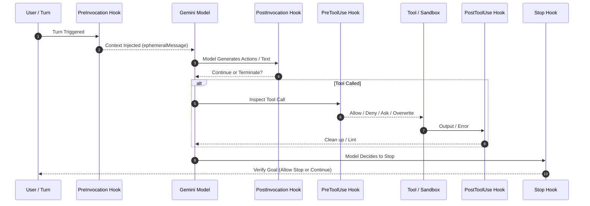

# The Cortex Execution Loop & Reactive Wakeup

At the core of Google Antigravity is **Cortex**, an asynchronous, event-driven agent runtime designed to eliminate busy-waiting, minimize token latency, and reliably coordinate tools and subagents.

---

## 1. Traditional Agents vs. Antigravity Cortex

```
[Traditional Agent Loop]
Prompt -> Model -> Tool Call -> Busy-Poll / Sleep Loop -> Read stdout -> Model (Repeats)
Problem: Burns CPU cycles, wastes tokens on polling messages, times out easily.

[Antigravity Cortex Loop]
Prompt -> Model -> Tool Call Launched (Async) -> Cortex Suspends Turn
         ^                                              |
         |=== Wakeup Event (Process Finished / Timer) ==|
```

In Antigravity:
1. **Async by Default**: Tools such as `run_command` or background tasks return immediately if long-running.
2. **Reactive Wakeup**: When a background process terminates or writes output, or when a scheduled timer fires, the system automatically resumes the agent turn with the complete message payload.
3. **Zero Polling**: Agents are instructed never to run loops or poll status endpoints.

---

## 2. The Five Lifecycle Hook Stages

Cortex exposes five deterministic interception points for custom code:



Each stage communicates over standard `stdin` and `stdout` using protojson camelCase structures.
