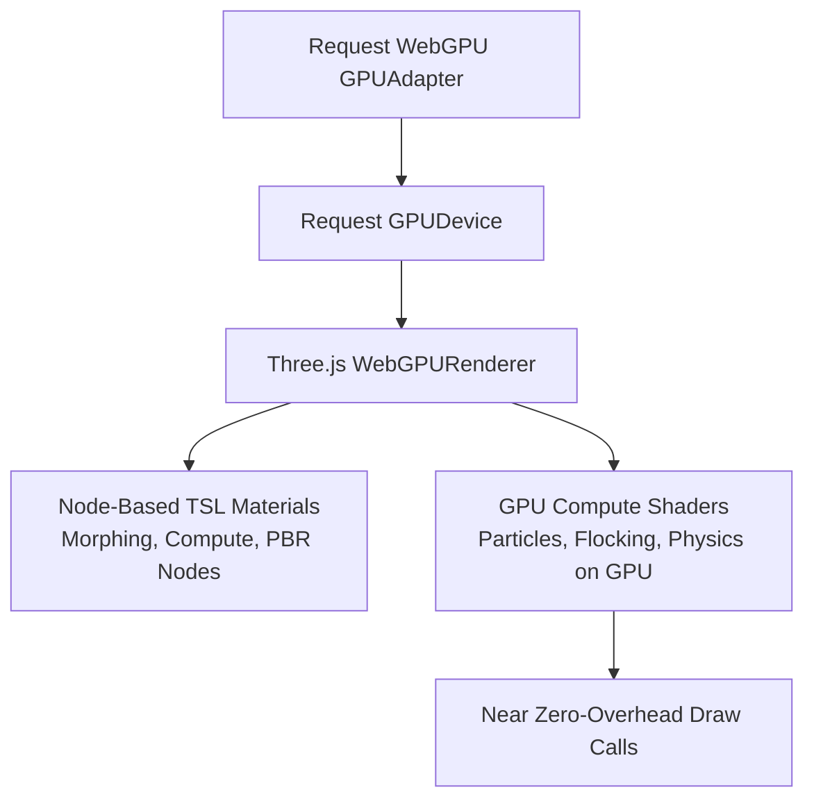

# Argon WebGPU & Next-Gen PBR (`argon-webgpu-pbr`)

The **Argon WebGPU PBR** skill harnesses Gemini 4 Argon to construct modern WebGPU rendering pipelines using Three.js WebGPU capabilities and Three.js Shading Language (TSL) node-based materials.

---

## ⚡ WebGPU Architecture Overview



---

## 🚀 Three.js WebGPURenderer Setup

```typescript
import * as THREE from 'three';
// Import WebGPU renderer and TSL nodes
import WebGPURenderer from 'three/examples/jsm/renderers/webgpu/WebGPURenderer.js';
import { color, positionLocal, time, vec3 } from 'three/examples/jsm/nodes/Nodes.js';

export class ArgonWebGPUScene {
  private renderer: WebGPURenderer;
  private scene: THREE.Scene;
  private camera: THREE.PerspectiveCamera;

  constructor(container: HTMLElement) {
    this.scene = new THREE.Scene();
    this.camera = new THREE.PerspectiveCamera(
      60,
      container.clientWidth / container.clientHeight,
      0.1,
      1000
    );
    this.camera.position.set(0, 2, 5);

    // Initialize next-generation WebGPU renderer
    this.renderer = new WebGPURenderer({ antialias: true });
    this.renderer.setSize(container.clientWidth, container.clientHeight);
    this.renderer.setPixelRatio(Math.min(window.devicePixelRatio, 2));
    container.appendChild(this.renderer.domElement);

    this.setupNodes();
  }

  private setupNodes(): void {
    // TSL Node Material example
    const geometry = new THREE.SphereGeometry(1.2, 64, 64);
    
    // Create animated procedural vertex displacement node
    const animatedPosition = positionLocal.add(
      vec3(0.0, time.sin().mul(0.2), 0.0)
    );

    const material = new THREE.MeshStandardNodeMaterial({
      colorNode: color(0x00e5ff),
      roughness: 0.2,
      metalness: 0.8
    });
    material.positionNode = animatedPosition;

    const mesh = new THREE.Mesh(geometry, material);
    this.scene.add(mesh);
  }

  public render(): void {
    this.renderer.renderAsync(this.scene, this.camera);
  }
}
```

