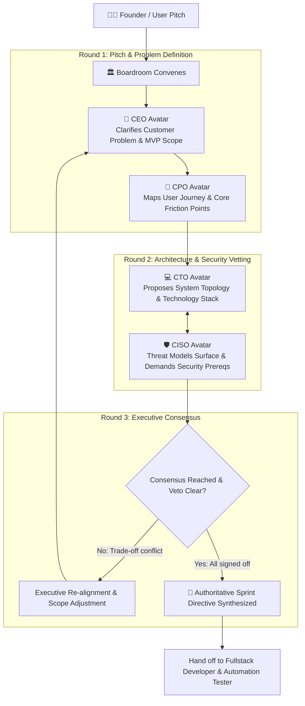

# Agency Boardroom Protocol (`agency-boardroom`)

The **Agency Boardroom Protocol** convenes an executive C-Suite meeting inside Google Antigravity before any code is authored. By orchestrating a structured debate between the **CEO** (business value), **CPO** (user empathy), **CTO** (scalability and architecture), and **CISO** (zero-trust security), it eliminates misaligned assumptions, prevents architectural drift, and generates an authoritative development blueprint.

---

## 🏛️ Executive Boardroom Consensus Flow



---

## 📋 The 5-Step Boardroom Agenda

### 1. The CEO Scoping Mandate
The `ceo` establishes the business anchor:
* **The Core Problem**: Exactly what pain point are we solving?
* **MVP Horizon**: What features are strictly required for launch? What must be discarded to ship on time?
* **Key Success Metrics**: Speed, conversion, latency, or customer retention targets.

### 2. The CPO User Experience Decomposition
The `cpo` challenges assumptions through customer empathy:
* **User Personas**: Who is using this, and under what conditions?
* **Edge Cases & Empty States**: How does the user onboard? What happens when network or data is missing?
* **Acceptance Criteria**: Formatted `Given-When-Then` BDD scenarios.

### 3. The CTO Architectural Synthesis
The `cto` proposes the technical foundation:
* **Pattern Selection**: Microservices vs Modular Monolith; Server-Side Rendering (SSR) vs Single-Page Application (SPA).
* **Persistence & Schema**: Database selection (PostgreSQL, Supabase, Spanner, Redis) with ACID transaction boundaries.
* **Component Boundaries**: Clean domain separation preventing spaghetti dependencies.

### 4. The CISO Security Vetting
The `ciso` enforces defensive engineering:
* **Threat Surface**: Identified trust boundaries and potential injection/auth vectors.
* **Security Invariants**: Mandatory authentication (JWT/OAuth), Row-Level Security (RLS), parameterized queries, and zero hardcoded secrets.
* **Veto Power**: The CISO will veto the plan if sensitive data is handled insecurely.

### 5. Unified Executive Output: The Sprint Directive
Once consensus is reached, the Boardroom outputs a unified **Company Sprint Directive (`docs/business/SPRINT_DIRECTIVE.md`)** detailing:
* Executive Scope boundaries signed by the CEO.
* Technical architecture blueprint signed by the CTO.
* Security requirements and compliance gate signed by the CISO.
* User stories and acceptance criteria signed by the CPO.

---

## 🛠️ CLI Boardroom Execution

Run the Boardroom directly from the terminal or chat:

```bash
# 1. Convene a boardroom debate on a project topic
everything-gemini agency boardroom "Build multi-tenant SaaS billing with Stripe"

# 2. Inspect active boardroom quorum and executive avatars
everything-gemini agency status

# 3. Verify security veto criteria
everything-gemini agency veto-check
```
