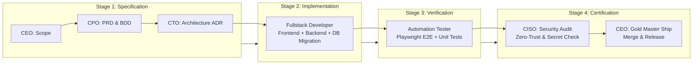

# Agency Sprint Runner (`agency-sprint-runner`)

The **Agency Sprint Runner** coordinates multi-role autonomous sprints across the virtual software agency. By moving work through four sequential, gated stages—**Spec**, **Build**, **Verify**, and **Certify**—it guarantees that features are built to specification, tested against regressions, vetted for security, and signed off before release.

---

## 🏃 The 4-Stage Sprint Execution Pipeline

---

## 📋 The 4 Gated Stages

### Stage 1: Specification & Architecture Gate
* **Participants**: `ceo`, `cpo`, `cto`, `ciso`.
* **Protocol**:
  1. `ceo` sets the MVP scope boundaries.
  2. `cpo` drafts user stories with BDD acceptance criteria (`docs/product/PRD.md`).
  3. `cto` authors the Architecture Decision Record (`docs/architecture/ADR.md`) and selects the data model.
  4. `ciso` adds mandatory security invariants (authentication, RLS, input sanitization).
* **Exit Gate**: All 4 executives sign the Sprint Directive.

### Stage 2: Fullstack Engineering Gate
* **Participants**: `fullstack-developer`.
* **Protocol**:
  1. Implements database models and migrations with foreign key constraints.
  2. Implements backend API endpoints with input validation (Zod/Pydantic) and error envelopes.
  3. Implements responsive frontend UI components using modern component libraries (shadcn/ui, Tailwind).
  4. Runs type-checking (`tsc --noEmit`) and local unit tests with zero errors.
* **Exit Gate**: PR diff passes linter and type-checker with clean, minimal changes.

### Stage 3: Automated Quality & Regression Gate
* **Participants**: `automation-tester`.
* **Protocol**:
  1. Ingests BDD scenarios from the PRD and writes end-to-end Playwright tests.
  2. Executes tests covering Happy Path, error states, and responsive viewports (Mobile & Desktop).
  3. Asserts 100% passing tests with zero console exceptions or unhandled promise rejections.
* **Exit Gate**: Formal QA Certification report (`docs/qa/TEST_REPORT.md`) passes.

### Stage 4: Security Certification & Executive Sign-Off
* **Participants**: `ciso`, `ceo`.
* **Protocol**:
  1. `ciso` scans repository for hardcoded secrets, runs dependency audits, and verifies access control.
  2. `ciso` issues formal Security Clearance.
  3. `ceo` verifies business objectives and approves the final production release.
* **Exit Gate**: Unanimous executive clearance; release tagged and ready to ship.

---

## 🚀 Running an Autonomous Sprint

Trigger an autonomous sprint in chat:

> *"Act as the `agency-sprint-runner`. Convene the agency avatars (`ceo`, `cpo`, `cto`, `fullstack-developer`, `automation-tester`, `ciso`) to execute an end-to-end sprint for: **User Onboarding with Magic Link Authentication**.*
> 
> *1. Stage 1 (Spec): CPO & CTO create PRD and ADR.*
> *2. Stage 2 (Build): Fullstack Developer creates the database schema, auth API, and login page.*
> *3. Stage 3 (Verify): Automation Tester runs E2E tests for successful login and expired token handling.*
> *4. Stage 4 (Certify): CISO audits for credential hygiene, and CEO approves the release."*
