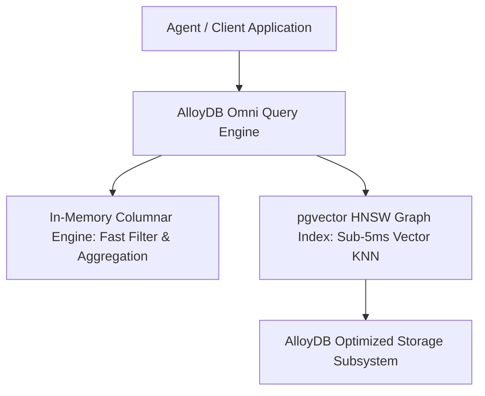

# AlloyDB Omni with pgvector & Columnar Acceleration (`alloydb-omni-vector`)

This skill provides configuration guidelines, schema blueprints, and HNSW index tuning for running **Google Cloud AlloyDB Omni** with `pgvector` and the vectorized columnar engine for scalable, high-throughput vector search.

---

## ⚡ Architecture: Columnar Engine + pgvector



---

## 🛠️ Docker Deployment with Omni CLI

```bash
# 1. Install AlloyDB Omni CLI
curl -fsSL https://alloydb-omni.cloud.google.com/install.sh | bash

# 2. Launch AlloyDB Omni container with pgvector and 8GB RAM
alloydb-omni-cli launch prod-omni \
  --memory 8GB \
  --cpu 4 \
  --storage-dir /var/lib/alloydb-data \
  --port 5432
```

---

## 💾 Database Configuration & HNSW Schema

```sql
-- 1. Enable required extensions
CREATE EXTENSION IF NOT EXISTS vector;
CREATE EXTENSION IF NOT EXISTS google_columnar_engine;

-- 2. Configure columnar engine allocations
ALTER SYSTEM SET google_columnar_engine.enabled = 'on';
ALTER SYSTEM SET google_columnar_engine.memory_size_in_mb = 4096;
SELECT pg_reload_conf();

-- 3. Create Vector Table
CREATE TABLE KnowledgeEmbeddings (
  id UUID PRIMARY KEY DEFAULT gen_random_uuid(),
  chunk_text TEXT NOT NULL,
  metadata JSONB,
  embedding vector(768) NOT NULL
);

-- 4. Create HNSW Vector Index with high-recall parameters
CREATE INDEX ON KnowledgeEmbeddings 
USING hnsw (embedding vector_cosine_ops)
WITH (m = 24, ef_construction = 128);
```

---

## 🔍 Hybrid Vector Query with Columnar Filtering

```sql
SELECT 
  id, 
  chunk_text, 
  metadata->>'source' AS doc_source,
  1 - (embedding <=> '[0.012, -0.045, ...]'::vector) AS similarity
FROM KnowledgeEmbeddings
WHERE metadata->>'category' = 'security_runbook'
ORDER BY embedding <=> '[0.012, -0.045, ...]'::vector
LIMIT 10;
```

---

## 🛡️ Production Tuning Invariants
1. **`ef_search` Tuning**: Dynamically set `SET hnsw.ef_search = 64;` during read queries for optimal speed vs. recall Pareto efficiency.
2. **Columnar Engine Synergy**: Pre-filter categorical metadata using AlloyDB Columnar Engine before computing vector cosine distances.
