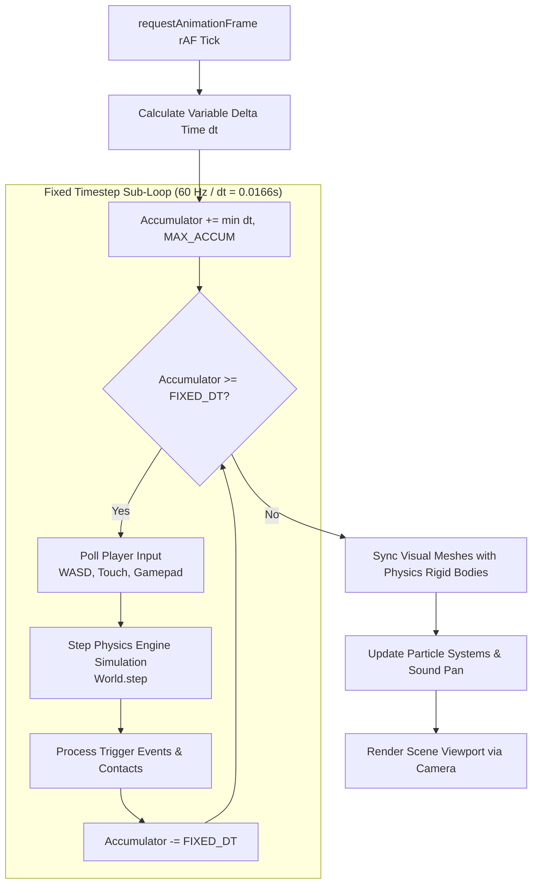

# Argon 3D Game Engine (`argon-3d-game-engine`)

The **Argon 3D Game Engine** skill guides the construction of real-time browser games using Gemini 4 Argon's physics and state synchronization capabilities. It bridges Three.js visual scene graphs with deterministic rigid-body physics (Rapier.js or Cannon-es).

---

## 🎮 Decoupled Game Loop Architecture



---

## 🏎️ Arcade Vehicle / Player Controller Implementation

Here is an architectural pattern for an arcade-style player controller combining Three.js rendering with `@dimforge/rapier3d-compat` (or `cannon-es`):

```typescript
import * as THREE from 'three';

export interface InputState {
  forward: boolean;
  backward: boolean;
  left: boolean;
  right: boolean;
  brake: boolean;
}

export class ArcadePlayerController {
  public mesh: THREE.Group;
  private input: InputState = {
    forward: false,
    backward: false,
    left: false,
    right: false,
    brake: false
  };

  // Kinematic parameters
  public speed = 0;
  public maxSpeed = 28;
  public acceleration = 18;
  public deceleration = 12;
  public turnSpeed = 2.4;
  public heading = 0;

  constructor() {
    this.mesh = new THREE.Group();
    this.buildVehicleMesh();
    this.bindKeyboard();
  }

  private buildVehicleMesh(): void {
    // Stylized low-poly vehicle body
    const bodyGeo = new THREE.BoxGeometry(1.6, 0.6, 3.2);
    const bodyMat = new THREE.MeshStandardMaterial({
      color: 0x00e5ff,
      roughness: 0.3,
      metalness: 0.8
    });
    const bodyMesh = new THREE.Mesh(bodyGeo, bodyMat);
    bodyMesh.position.y = 0.5;
    bodyMesh.castShadow = true;
    this.mesh.add(bodyMesh);

    // Cabin / Windshield
    const cabinGeo = new THREE.BoxGeometry(1.2, 0.5, 1.4);
    const cabinMat = new THREE.MeshStandardMaterial({
      color: 0x111625,
      roughness: 0.1,
      metalness: 0.9
    });
    const cabin = new THREE.Mesh(cabinGeo, cabinMat);
    cabin.position.set(0, 0.95, -0.2);
    cabin.castShadow = true;
    this.mesh.add(cabin);

    // Wheels
    const wheelGeo = new THREE.CylinderGeometry(0.35, 0.35, 0.3, 16);
    wheelGeo.rotateZ(Math.PI / 2);
    const wheelMat = new THREE.MeshStandardMaterial({ color: 0x222222, roughness: 0.8 });

    const positions = [
      [-0.85, 0.35, 1.0],  // Front Left
      [0.85, 0.35, 1.0],   // Front Right
      [-0.85, 0.35, -1.0], // Rear Left
      [0.85, 0.35, -1.0]   // Rear Right
    ];

    positions.forEach(([x, y, z]) => {
      const wheel = new THREE.Mesh(wheelGeo, wheelMat);
      wheel.position.set(x, y, z);
      wheel.castShadow = true;
      this.mesh.add(wheel);
    });
  }

  private bindKeyboard(): void {
    window.addEventListener('keydown', (e) => this.handleKey(e.code, true));
    window.addEventListener('keyup', (e) => this.handleKey(e.code, false));
  }

  private handleKey(code: string, pressed: boolean): void {
    switch (code) {
      case 'KeyW':
      case 'ArrowUp':
        this.input.forward = pressed;
        break;
      case 'KeyS':
      case 'ArrowDown':
        this.input.backward = pressed;
        break;
      case 'KeyA':
      case 'ArrowLeft':
        this.input.left = pressed;
        break;
      case 'KeyD':
      case 'ArrowRight':
        this.input.right = pressed;
        break;
      case 'Space':
        this.input.brake = pressed;
        break;
    }
  }

  public update(fixedDelta: number): void {
    // 1. Acceleration & Braking
    if (this.input.forward) {
      this.speed = Math.min(this.speed + this.acceleration * fixedDelta, this.maxSpeed);
    } else if (this.input.backward) {
      this.speed = Math.max(this.speed - this.deceleration * fixedDelta, -this.maxSpeed * 0.4);
    } else {
      // Natural rolling friction
      if (this.speed > 0) {
        this.speed = Math.max(0, this.speed - this.deceleration * 0.5 * fixedDelta);
      } else if (this.speed < 0) {
        this.speed = Math.min(0, this.speed + this.deceleration * 0.5 * fixedDelta);
      }
    }

    if (this.input.brake) {
      this.speed *= Math.max(0, 1 - 4 * fixedDelta);
    }

    // 2. Steering (speed-dependent)
    if (Math.abs(this.speed) > 0.1) {
      const turnFactor = this.speed > 0 ? 1 : -1;
      if (this.input.left) this.heading += this.turnSpeed * turnFactor * fixedDelta;
      if (this.input.right) this.heading -= this.turnSpeed * turnFactor * fixedDelta;
    }

    // 3. Translation & Rotation
    this.mesh.rotation.y = this.heading;
    this.mesh.position.x += Math.sin(this.heading) * this.speed * fixedDelta;
    this.mesh.position.z += Math.cos(this.heading) * this.speed * fixedDelta;
  }
}
```

---

## 🎥 Third-Person Camera Follow Rig

A smooth third-person camera prevents motion sickness through damped interpolation (`lerp`):

```typescript
export function updateFollowCamera(
  camera: THREE.PerspectiveCamera,
  targetPosition: THREE.Vector3,
  targetHeading: number,
  delta: number
): void {
  // Ideal camera offset relative to player
  const distance = 8.0;
  const height = 4.0;
  const idealX = targetPosition.x - Math.sin(targetHeading) * distance;
  const idealZ = targetPosition.z - Math.cos(targetHeading) * distance;
  const idealY = targetPosition.y + height;

  const idealPosition = new THREE.Vector3(idealX, idealY, idealZ);

  // Smooth lerp camera position
  camera.position.lerp(idealPosition, 1 - Math.exp(-6 * delta));

  // Look ahead of vehicle
  const lookAtTarget = targetPosition.clone().add(
    new THREE.Vector3(Math.sin(targetHeading) * 4, 1.0, Math.cos(targetHeading) * 4)
  );
  camera.lookAt(lookAtTarget);
}
```

---

## 🎯 Game State Management Protocol

Every Argon 3D game must define explicit finite state transitions:

```typescript
export enum GameState {
  BOOTING = 'BOOTING',
  READY = 'READY',
  PLAYING = 'PLAYING',
  PAUSED = 'PAUSED',
  GAME_OVER = 'GAME_OVER'
}

export class GameStateManager {
  private state: GameState = GameState.BOOTING;

  public transition(next: GameState): void {
    console.log(`[Argon GameState] ${this.state} -> ${next}`);
    this.state = next;
  }

  public isPlaying(): boolean {
    return this.state === GameState.PLAYING;
  }
}
```

