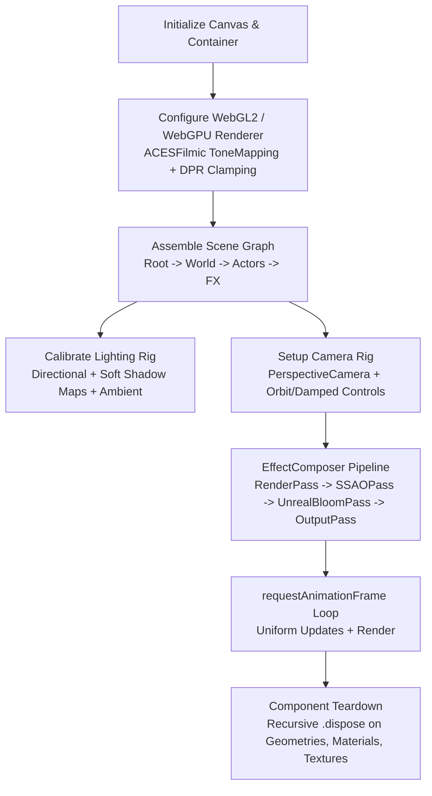

# Argon 3D Scene Architect (`argon-3d-scene-architect`)

The **Argon 3D Scene Architect** skill harnesses Gemini 4 Argon's spatial reasoning to design, structure, and optimize production-grade Three.js and WebGPU 3D browser applications with strict 60 FPS performance, realistic PBR lighting, and robust memory lifecycles.

---

## 🏛️ Rendering Pipeline Architecture



---

## ⚡ Core Scene Invariants

1. **Device Pixel Ratio (DPR) Clamping**: Never set DPR directly to `window.devicePixelRatio`. Modern 4K and Retina screens will render at 3x or 4x scale, decimating GPU fill rate.
   ```javascript
   renderer.setPixelRatio(Math.min(window.devicePixelRatio, 2));
   ```
2. **Color Management & Tone Mapping**: Always enable standard sRGB output and cinematic tone mapping for realistic physical materials:
   ```javascript
   renderer.outputColorSpace = THREE.SRGBColorSpace;
   renderer.toneMapping = THREE.ACESFilmicToneMapping;
   renderer.toneMappingExposure = 1.0;
   ```
3. **Shadow Optimization**: Size the directional light's orthographic shadow camera tightly around the playable area. Keep shadow map resolution at $2048 \times 2048$ or below with soft filtering:
   ```javascript
   renderer.shadowMap.enabled = true;
   renderer.shadowMap.type = THREE.PCFSoftShadowMap;
   ```

---

## 🛠️ Production Scene Blueprint (TypeScript / Three.js)

```typescript
import * as THREE from 'three';
import { OrbitControls } from 'three/examples/jsm/controls/OrbitControls.js';
import { EffectComposer } from 'three/examples/jsm/postprocessing/EffectComposer.js';
import { RenderPass } from 'three/examples/jsm/postprocessing/RenderPass.js';
import { UnrealBloomPass } from 'three/examples/jsm/postprocessing/UnrealBloomPass.js';
import { OutputPass } from 'three/examples/jsm/postprocessing/OutputPass.js';

export class ArgonScene {
  private container: HTMLElement;
  private scene: THREE.Scene;
  private camera: THREE.PerspectiveCamera;
  private renderer: THREE.WebGLRenderer;
  private composer: EffectComposer;
  private controls: OrbitControls;
  private animationFrameId: number | null = null;
  private clock = new THREE.Clock();

  constructor(container: HTMLElement) {
    this.container = container;
    const width = container.clientWidth || window.innerWidth;
    const height = container.clientHeight || window.innerHeight;

    // 1. Scene
    this.scene = new THREE.Scene();
    this.scene.background = new THREE.Color(0x0a0c14);
    this.scene.fog = new THREE.FogExp2(0x0a0c14, 0.02);

    // 2. Camera
    this.camera = new THREE.PerspectiveCamera(50, width / height, 0.1, 1000);
    this.camera.position.set(0, 8, 15);

    // 3. Renderer
    this.renderer = new THREE.WebGLRenderer({
      antialias: true,
      powerPreference: 'high-performance'
    });
    this.renderer.setSize(width, height);
    this.renderer.setPixelRatio(Math.min(window.devicePixelRatio, 2));
    this.renderer.shadowMap.enabled = true;
    this.renderer.shadowMap.type = THREE.PCFSoftShadowMap;
    this.renderer.toneMapping = THREE.ACESFilmicToneMapping;
    this.renderer.toneMappingExposure = 1.1;
    this.renderer.outputColorSpace = THREE.SRGBColorSpace;
    this.container.appendChild(this.renderer.domElement);

    // 4. Controls
    this.controls = new OrbitControls(this.camera, this.renderer.domElement);
    this.controls.enableDamping = true;
    this.controls.dampingFactor = 0.05;
    this.controls.maxPolarAngle = Math.PI / 2 - 0.05;

    // 5. Lighting Rig
    this.setupLighting();

    // 6. Post-Processing Pipeline
    this.composer = new EffectComposer(this.renderer);
    this.composer.addPass(new RenderPass(this.scene, this.camera));

    const bloomPass = new UnrealBloomPass(
      new THREE.Vector2(width, height),
      0.35, // Strength
      0.4,  // Radius
      0.85  // Threshold
    );
    this.composer.addPass(bloomPass);
    this.composer.addPass(new OutputPass());

    // 7. Event Listeners
    window.addEventListener('resize', this.onResize);
    this.renderer.domElement.addEventListener('webglcontextlost', this.onContextLost, false);
    this.renderer.domElement.addEventListener('webglcontextrestored', this.onContextRestored, false);

    this.start();
  }

  private setupLighting(): void {
    const ambientLight = new THREE.AmbientLight(0xffffff, 0.4);
    this.scene.add(ambientLight);

    const dirLight = new THREE.DirectionalLight(0xffeedd, 1.8);
    dirLight.position.set(12, 20, 10);
    dirLight.castShadow = true;
    dirLight.shadow.mapSize.width = 2048;
    dirLight.shadow.mapSize.height = 2048;
    dirLight.shadow.camera.near = 0.5;
    dirLight.shadow.camera.far = 60;

    const d = 15;
    dirLight.shadow.camera.left = -d;
    dirLight.shadow.camera.right = d;
    dirLight.shadow.camera.top = d;
    dirLight.shadow.camera.bottom = -d;
    dirLight.shadow.bias = -0.0002;
    this.scene.add(dirLight);

    // Subtle blue fill light from opposite angle
    const fillLight = new THREE.DirectionalLight(0x4488ff, 0.6);
    fillLight.position.set(-10, 8, -10);
    this.scene.add(fillLight);
  }

  private onResize = (): void => {
    const width = this.container.clientWidth || window.innerWidth;
    const height = this.container.clientHeight || window.innerHeight;
    this.camera.aspect = width / height;
    this.camera.updateProjectionMatrix();
    this.renderer.setSize(width, height);
    this.composer.setSize(width, height);
  };

  private onContextLost = (e: Event): void => {
    e.preventDefault();
    if (this.animationFrameId) cancelAnimationFrame(this.animationFrameId);
    console.warn('[Argon 3D] WebGL context lost. Pausing render loop.');
  };

  private onContextRestored = (): void => {
    console.info('[Argon 3D] WebGL context restored. Rebuilding scene pipeline.');
    this.start();
  };

  public start(): void {
    const animate = (): void => {
      this.animationFrameId = requestAnimationFrame(animate);
      this.controls.update();
      this.composer.render();
    };
    animate();
  }

  public dispose(): void {
    if (this.animationFrameId) cancelAnimationFrame(this.animationFrameId);
    window.removeEventListener('resize', this.onResize);

    // Recursive scene teardown to prevent GPU memory leaks
    this.scene.traverse((child) => {
      if ((child as THREE.Mesh).isMesh) {
        const mesh = child as THREE.Mesh;
        mesh.geometry?.dispose();
        if (Array.isArray(mesh.material)) {
          mesh.material.forEach((mat) => mat.dispose());
        } else {
          mesh.material?.dispose();
        }
      }
    });

    this.renderer.dispose();
    this.composer.dispose();
    if (this.renderer.domElement.parentNode) {
      this.renderer.domElement.parentNode.removeChild(this.renderer.domElement);
    }
  }
}
```

---

## 📊 Performance & Optimization Checklist

- [ ] **Draw Calls**: Verified below 100 per frame using `renderer.info.render.calls`.
- [ ] **Geometry Batching**: Repeated meshes batched using `THREE.InstancedMesh`.
- [ ] **Texture Compression**: Mipmaps enabled, max resolution 2048x2048, KTX2/Basis Universal when feasible.
- [ ] **Frustum Culling**: Default `frustumCulled = true` verified on all meshes.
- [ ] **Shadow Camera Bounds**: Bounding frustum tightly fitted to the active gameplay area to preserve shadow map texel density.

