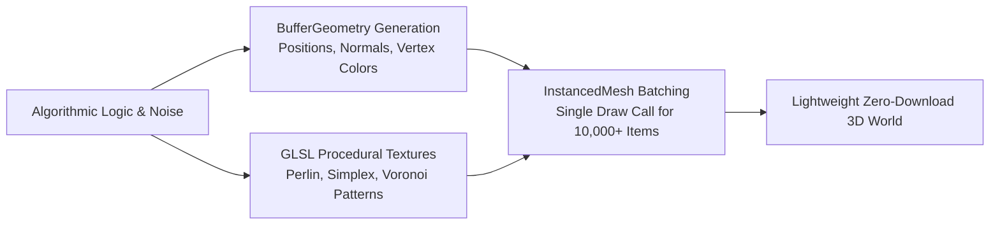

# Argon Procedural Asset Generator (`argon-procedural-asset-generator`)

The **Argon Procedural Asset Generator** skill leverages Gemini 4 Argon's mathematical and spatial reasoning to generate 3D assets on the fly. By replacing multi-megabyte binary 3D downloads with algorithmic mesh builders and procedural canvas textures, applications load in milliseconds and run with zero external model assets.

---

## 🌲 Procedural Generation Paradigms



---

## ⛰️ Procedural Low-Poly Terrain with Vertex Colors

Procedural terrains eliminate texture maps by baking elevation-based color gradients directly into vertex attributes:

```typescript
import * as THREE from 'three';

// Fast 2D Simplex/Value Noise function
function pseudoNoise(x: number, z: number): number {
  return (
    Math.sin(x * 0.15) * Math.cos(z * 0.15) * 2.5 +
    Math.sin(x * 0.05 + 1.2) * Math.cos(z * 0.05 + 0.8) * 5.0
  );
}

export function createProceduralTerrain(
  size = 60,
  segments = 40
): THREE.Mesh {
  const geometry = new THREE.PlaneGeometry(size, size, segments, segments);
  geometry.rotateX(-Math.PI / 2);

  const pos = geometry.attributes.position;
  const count = pos.count;
  const colors = new Float32Array(count * 3);

  // Elevation color palette
  const sandColor = new THREE.Color(0xd2b48c);
  const grassColor = new THREE.Color(0x2e8b57);
  const rockColor = new THREE.Color(0x708090);
  const snowColor = new THREE.Color(0xf8f8ff);

  for (let i = 0; i < count; i++) {
    const x = pos.getX(i);
    const z = pos.getZ(i);
    const y = pseudoNoise(x, z);
    pos.setY(i, y);

    // Compute color based on elevation
    const vertexColor = new THREE.Color();
    if (y < 0.5) {
      vertexColor.copy(sandColor);
    } else if (y < 3.5) {
      vertexColor.lerpColors(grassColor, rockColor, (y - 0.5) / 3.0);
    } else {
      vertexColor.lerpColors(rockColor, snowColor, (y - 3.5) / 3.0);
    }

    colors[i * 3] = vertexColor.r;
    colors[i * 3 + 1] = vertexColor.g;
    colors[i * 3 + 2] = vertexColor.b;
  }

  geometry.setAttribute('color', new THREE.BufferAttribute(colors, 3));
  geometry.computeVertexNormals();

  const material = new THREE.MeshStandardMaterial({
    vertexColors: true,
    roughness: 0.85,
    metalness: 0.1,
    flatShading: true // Low-poly faceted aesthetic
  });

  const terrain = new THREE.Mesh(geometry, material);
  terrain.receiveShadow = true;
  return terrain;
}
```

---

## 🌳 Procedural Low-Poly Pine Tree Builder

Synthesize distinct botanical props by composing geometric primitives into combined geometries:

```typescript
export function createLowPolyTree(): THREE.Group {
  const tree = new THREE.Group();

  // 1. Trunk
  const trunkGeo = new THREE.CylinderGeometry(0.2, 0.35, 1.6, 6);
  const trunkMat = new THREE.MeshStandardMaterial({
    color: 0x5c4033,
    roughness: 0.9,
    flatShading: true
  });
  const trunk = new THREE.Mesh(trunkGeo, trunkMat);
  trunk.position.y = 0.8;
  trunk.castShadow = true;
  tree.add(trunk);

  // 2. Foliage Cones (Stacked)
  const foliageMat = new THREE.MeshStandardMaterial({
    color: 0x228b22,
    roughness: 0.7,
    flatShading: true
  });

  const tiers = [
    { radius: 1.4, height: 1.6, y: 1.8 },
    { radius: 1.1, height: 1.4, y: 2.7 },
    { radius: 0.7, height: 1.1, y: 3.5 }
  ];

  tiers.forEach((tier) => {
    const coneGeo = new THREE.ConeGeometry(tier.radius, tier.height, 6);
    const cone = new THREE.Mesh(coneGeo, foliageMat);
    cone.position.y = tier.y;
    cone.castShadow = true;
    tree.add(cone);
  });

  return tree;
}
```

---

## 🚀 Massive Instanced Scattering (`InstancedMesh`)

Scatter thousands of procedural trees across terrain in a **single draw call**:

```typescript
export function scatterInstancedTrees(
  count: number,
  areaSize: number
): THREE.InstancedMesh {
  const baseCone = new THREE.ConeGeometry(1.2, 2.5, 6);
  const foliageMat = new THREE.MeshStandardMaterial({
    color: 0x2e8b57,
    flatShading: true,
    roughness: 0.8
  });

  const instancedMesh = new THREE.InstancedMesh(baseCone, foliageMat, count);
  instancedMesh.castShadow = true;
  instancedMesh.receiveShadow = true;

  const dummy = new THREE.Object3D();
  const color = new THREE.Color();

  for (let i = 0; i < count; i++) {
    const x = (Math.random() - 0.5) * areaSize;
    const z = (Math.random() - 0.5) * areaSize;
    const y = pseudoNoise(x, z) + 1.25;

    dummy.position.set(x, y, z);
    const scale = 0.6 + Math.random() * 0.8;
    dummy.scale.set(scale, scale, scale);
    dummy.rotation.y = Math.random() * Math.PI * 2;
    dummy.updateMatrix();

    instancedMesh.setMatrixAt(i, dummy.matrix);

    // Subtle color variation per instance
    color.setHSL(0.3 + (Math.random() - 0.5) * 0.05, 0.7, 0.35 + Math.random() * 0.15);
    instancedMesh.setColorAt(i, color);
  }

  instancedMesh.instanceMatrix.needsUpdate = true;
  if (instancedMesh.instanceColor) instancedMesh.instanceColor.needsUpdate = true;

  return instancedMesh;
}
```

---

## 🎨 Canvas-Generated Procedural Textures

Generate seamless grid, road, or terrain textures in memory without external image assets:

```typescript
export function createProceduralGridTexture(size = 512): THREE.CanvasTexture {
  const canvas = document.createElement('canvas');
  canvas.width = size;
  canvas.height = size;
  const ctx = canvas.getContext('2d')!;

  ctx.fillStyle = '#141824';
  ctx.fillRect(0, 0, size, size);

  // Glowing grid lines
  ctx.strokeStyle = '#00e5ff22';
  ctx.lineWidth = 4;
  const step = size / 8;

  for (let i = 0; i <= size; i += step) {
    ctx.beginPath();
    ctx.moveTo(i, 0);
    ctx.lineTo(i, size);
    ctx.stroke();

    ctx.beginPath();
    ctx.moveTo(0, i);
    ctx.lineTo(size, i);
    ctx.stroke();
  }

  const texture = new THREE.CanvasTexture(canvas);
  texture.wrapS = THREE.RepeatWrapping;
  texture.wrapT = THREE.RepeatWrapping;
  texture.repeat.set(10, 10);
  return texture;
}
```

