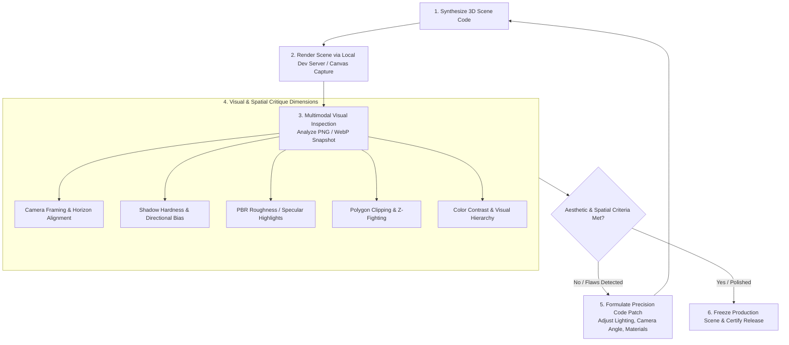

# Argon Visual Critique Loop (`argon-visual-critique-loop`)

The **Argon Visual Critique Loop** is Gemini 4 Argon's signature development methodology. Instead of blind code generation, the agent inspects rendered 3D frames through Antigravity's multimodal vision and Generative UI/Sidecar systems, systematically audits lighting, composition, and clipping, and applies corrective code patches.

---

## 🔄 Visual Critique Execution Cycle



---

## 🔍 The 6-Dimension Visual Critique Checklist

When Gemini 4 Argon or the `spatial-game-architect` reviews a rendered 3D frame, it evaluates:

| Dimension | Common Defect | Argon Self-Correction |
| :--- | :--- | :--- |
| **1. Camera & Horizon** | Camera too low or tilted uncomfortably; horizon line cutting awkwardly across actors. | Adjust `camera.position.set(x, y, z)` and `camera.lookAt()`. Increase field of view (FOV) from 45 to 60 for expansive scenes. |
| **2. Lighting Contrast** | Scene washed out (ambient light too strong) or pitch black in shadows. | Lower `AmbientLight` intensity to 0.3-0.5. Add subtle directional fill light (`0x4488ff`) from opposite vector. |
| **3. Shadow Fidelity** | Shadow acne (striping on surfaces) or peter-panning (shadow detached from object base). | Tune `light.shadow.bias` (typically `-0.0001` to `-0.0005`) and tighten `shadow.camera` bounds. |
| **4. PBR Reflections** | Materials look like plastic or unrendered grey placeholders. | Calibrate `roughness` (0.2 for shiny, 0.8 for matte) and `metalness` (0.0 for dielectrics, 0.8+ for metals). Ensure `envMap` or PMREM is enabled. |
| **5. Clipping & Scale** | Trees or vehicles penetrating geometry; ground planes causing Z-fighting flicker. | Offset coplanar meshes by `0.01` along normal vector or enable `polygonOffset`. Verify bounding box scales. |
| **6. Color Atmosphere** | Scene feels sterile with stark black void background. | Add atmospheric fog (`new THREE.FogExp2(0x0a0c14, 0.02)`) and matching scene background color. |

---

## 📸 Automated Canvas Snapshot Script

Use this headless or browser-side helper to export clean visual frames for agent evaluation:

```typescript
export function captureSceneSnapshot(
  renderer: THREE.WebGLRenderer,
  scene: THREE.Scene,
  camera: THREE.Camera
): string {
  // Ensure current frame is rendered
  renderer.render(scene, camera);

  // Extract high-resolution base64 data URL
  const dataUrl = renderer.domElement.toDataURL('image/webp', 0.92);
  return dataUrl;
}

// In Node / Puppeteer headless environments:
export async function auditSceneFrame(page: any): Promise<string> {
  const base64Image = await page.evaluate(() => {
    const canvas = document.querySelector('canvas');
    if (!canvas) throw new Error('No 3D canvas found on page');
    return canvas.toDataURL('image/png');
  });
  return base64Image;
}
```

---

## 🤖 Handoff & Self-Correction Example

When the visual critique detects an unpolished scene, it outputs a structured diagnostic:

```markdown
### 🖼️ Visual Critique Evaluation
- **Snapshot Analyzed**: `artifacts/scene-pass-1.png`
- **Defects Identified**:
  1. *Shadow Acne*: Striping visible on the terrain surface near vehicle tires.
  2. *Low Contrast*: Ambient light intensity at 1.2 drowns directional shadows.
  3. *Camera FOV*: FOV 75 causes extreme fish-eye distortion at screen edges.

### 🛠️ Corrective Code Actions
- Reduced `camera.fov` from 75 to 50.
- Decreased `AmbientLight` intensity from 1.2 to 0.4.
- Added `directionalLight.shadow.bias = -0.0002` to eliminate shadow acne.
```

