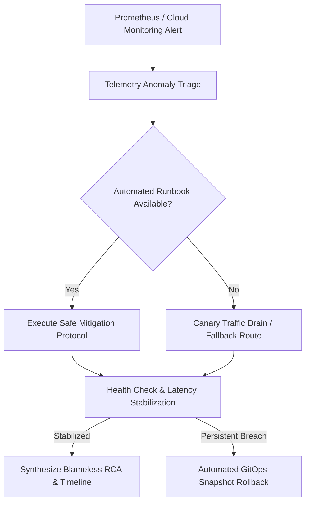

# Autonomous Incident Healer (`autonomous-incident-healer`)

The **Autonomous Incident Healer** is a mission-critical reliability skill designed to intercept production telemetry anomalies, execute deterministic mitigation runbooks, isolate failing replicas, and generate actionable post-mortems with regression reproduction harnesses.

---

## 🏛️ Autonomous Self-Healing Lifecycle



---

## 📋 Incident Response Playbooks

### 1. Connection Pool Exhaustion (HTTP 503 / PostgreSQL Conn Timeout)
When active connections breach $95\%$ capacity:
```bash
# 1. Inspect active connection locks and longest running queries
gcloud spanner databases execute-sql app-db --instance=prod-spanner \
  --sql="SELECT text_fingerprint, count, avg_latency_seconds FROM spanner_sys.query_stats_top_minute ORDER BY avg_latency_seconds DESC LIMIT 5;"

# 2. Shed non-critical background batch traffic via Envoy rate limits
curl -X POST http://envoy-admin:9901/runtime_modify?overload.global_downstream_max_connections=500

# 3. Scale read-pool replicas on Google Cloud Run
gcloud run services update orders-service --min-instances=10 --max-instances=50 --region=us-central1
```

### 2. Memory Leak & OOM Killer Remediation
When container RSS memory growth exceeds $15\%\text{/min}$ under steady RPS:
```bash
# 1. Trigger graceful rolling pod restart with zero downtime
kubectl rollout restart deployment/payment-gateway -n production

# 2. Capture core heap dump to Google Cloud Storage before recycling
gcloud storage cp /tmp/heapdump-$(date +%s).heapsnapshot gs://prod-diagnostics-artifacts/
```

### 3. Canary Anomaly Rollback Protocol
When canary error budget burn rate breaches $14.4\times$ over a 5-minute window:
```bash
# 1. Instantly shift 100% traffic back to stable baseline
gcloud deploy targets rollback prod-cluster --delivery-pipeline=core-services --region=us-central1

# 2. Emit incident telemetry span to OpenTelemetry Collector
curl -X POST http://otel-collector:4318/v1/traces \
  -H "Content-Type: application/json" \
  -d '{"resourceSpans":[{"resource":{"attributes":[{"key":"service.name","value":{"stringValue":"orders-canary"}}]},"scopeSpans":[{"spans":[{"name":"canary_rollback_triggered","status":{"code":2}}]}]}]}'
```

---

## 📝 Automated Post-Mortem & Timeline Synthesis

Upon recovery, compile a structured markdown post-mortem containing:
1. **Incident Trigger**: Metric alert, threshold breach, and timestamp.
2. **Mitigation Actions**: Specific CLI commands or traffic shifts executed by the agent.
3. **Time to Detect (TTD) & Time to Mitigate (TTM)**.
4. **Preventive Action Items**: Automated generation of a regression test PR using `harness3-mutation-testing`.
