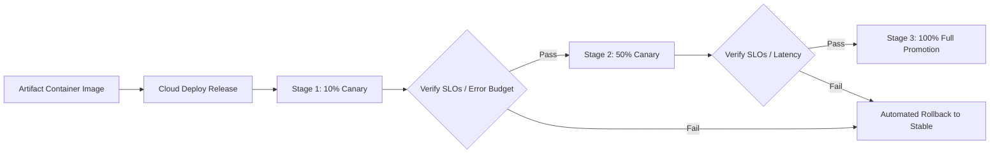

# Google Cloud Deploy Canary Delivery (`cloud-deploy-canary`)

This skill standardizes progressive delivery, multi-stage canary traffic splitting (10% $\to$ 25% $\to$ 50% $\to$ 100%), automated verification phases, and instant rollback gates utilizing **Google Cloud Deploy** across Google Cloud Run and Google Kubernetes Engine (GKE).

---

## 🚦 Canary Delivery Stages



---

## 📄 Cloud Deploy Delivery Pipeline (`clouddeploy.yaml`)

```yaml
apiVersion: deploy.cloud.google.com/v1
kind: DeliveryPipeline
metadata:
  name: core-services-pipeline
description: Production progressive canary deployment pipeline
serialPipeline:
  stages:
  - targetId: staging-cluster
    profiles: [staging]
  - targetId: prod-cluster
    profiles: [production]
    strategy:
      canary:
        runtimeConfig:
          cloudRun:
            automaticTrafficControl: true
        canaryDeployment:
          percentages: [10, 50]
          verify: true
```

---

## 💻 Canary Verification Job (`verify.yaml`)

```yaml
apiVersion: batch/v1
kind: Job
metadata:
  name: verify-canary-health
spec:
  template:
    spec:
      containers:
      - name: prometheus-slo-check
        image: gcr.io/google.com/cloudsdktool/google-cloud-cli:alpine
        command:
        - /bin/sh
        - -c
        - |
          echo "Inspecting 5-minute error rates on Canary revision..."
          ERROR_RATE=$(curl -s "http://prometheus:9090/api/v1/query?query=rate(http_requests_total{status=~'5..'}[5m])")
          if [ "$ERROR_RATE" -gt 0 ]; then
            echo "SLO Violation detected! Failing verification to trigger rollback."
            exit 1
          fi
          echo "Canary verified healthy."
      restartPolicy: Never
```

---

## 🛠️ Operational CLI Commands

```bash
# 1. Create a canary release
gcloud deploy releases create release-$(date +%Y%m%d-%H%M) \
  --delivery-pipeline=core-services-pipeline \
  --region=us-central1 \
  --images=app=gcr.io/my-project/orders-service:latest

# 2. Advance canary from 10% to 50%
gcloud deploy rollouts advance core-services-pipeline-prod-001 \
  --release=release-20261026 \
  --delivery-pipeline=core-services-pipeline \
  --region=us-central1

# 3. Emergency automated rollback
gcloud deploy targets rollback prod-cluster \
  --delivery-pipeline=core-services-pipeline \
  --region=us-central1
```
