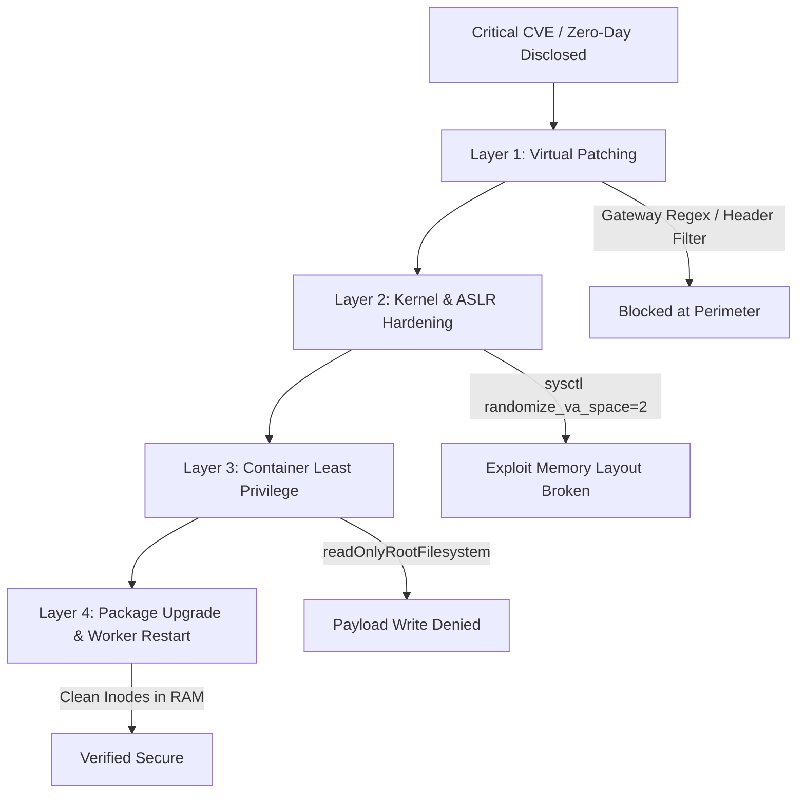

# CVE Remediation & Hardening Orchestrator (`cve-remediation-orchestrator`)

An enterprise security skill that coordinates four-layer defensive mitigations for critical CVEs, neutralizing attack vectors at the architecture, kernel, and gateway levels without referencing or running exploit scripts.

## Core Philosophy: Exploit-Agnostic Defense

Rather than tracking fragile or dangerous exploit PoCs, this skill enforces **architectural invariants** that render entire vulnerability classes inoperable:
1. **Virtual Patching**: Block malformed stream headers and buffer boundary exploits at the API gateway or WAF before they reach the runtime.
2. **Kernel & Host Hardening**: Enforce Full Address Space Layout Randomization (ASLR), Data Execution Prevention (DEP/NX), and strict Seccomp profiles to thwart memory exploitation primitives.
3. **Container Confinement**: Apply read-only root filesystems and drop all Linux capabilities to prevent post-exploitation persistence.
4. **Permanent Remediation**: Verify vendor package upgrades and ensure web worker daemons (`php-fpm`, `nginx`, `apache2`) are restarted so no stale vulnerable inodes remain mapped in RAM.

---

## Defense-in-Depth Architecture



---

## Remediation Runbook

### Layer 1: Ingress Virtual Patching (Envoy / WAF)
When official runtime packages cannot be deployed immediately, apply an edge filter to drop malicious header boundaries:

```yaml
# Envoy Gateway Filter Example
apiVersion: gateway.envoyproxy.io/v1alpha1
kind: EnvoyFilter
metadata:
  name: drop-malformed-boundaries
spec:
  configPatches:
    - applyTo: HTTP_FILTER
      match:
        context: SIDECAR_INBOUND
      patch:
        operation: INSERT_BEFORE
        value:
          name: envoy.filters.http.lua
          typed_config:
            "@type": type.googleapis.com/envoy.extensions.filters.http.lua.v3.Lua
            inlineCode: |
              function envoy_on_request(handle)
                local content_type = handle:headers():get("content-type")
                if content_type and string.find(content_type, "boundary=.*[\r\n\x00]") then
                  handle:respond({[":status"] = "400"}, "Malformed stream boundary rejected.")
                end
              end
```

### Layer 2: Host & Kernel ASLR Hardening
Ensure the host operating system enforces strict memory space randomization:

```bash
# Verify kernel ASLR level (2 = Full ASLR)
cat /proc/sys/kernel/randomize_va_space

# Enforce Full ASLR permanently
sudo sysctl -w kernel.randomize_va_space=2
echo "kernel.randomize_va_space = 2" | sudo tee -a /etc/sysctl.d/99-aslr-hardening.conf
```

### Layer 3: Container Runtime Confinement
Harden Kubernetes deployment manifests against shellcode execution and disk persistence:

```yaml
securityContext:
  allowPrivilegeEscalation: false
  readOnlyRootFilesystem: true
  runAsNonRoot: true
  runAsUser: 10001
  capabilities:
    drop:
      - ALL
```

### Layer 4: Permanent Patching & Worker Daemon Restart
Verify that running worker processes are executing the upgraded package:

```bash
# Run automated defense verification
bash skills/cve-remediation-orchestrator/scripts/verify-host-hardening.sh

# Verify no running workers hold unlinked deleted executables
ls -l /proc/*/exe 2>/dev/null | grep '(deleted)'
```

---

## Related Skills
- [phpcheck-server](file:///Users/salmanshaikh/development/github/everything-gemini/skills/phpcheck-server/SKILL.md) - Deep server and package backport auditor.
- [security-audit](file:///Users/salmanshaikh/development/github/everything-gemini/skills/security-audit/SKILL.md) - General code, dependency, and vulnerability analysis.
- [envoy-ai-gateway](file:///Users/salmanshaikh/development/github/everything-gemini/skills/envoy-ai-gateway/SKILL.md) - Production AI gateway routing, rate limiting, and virtual patching.
