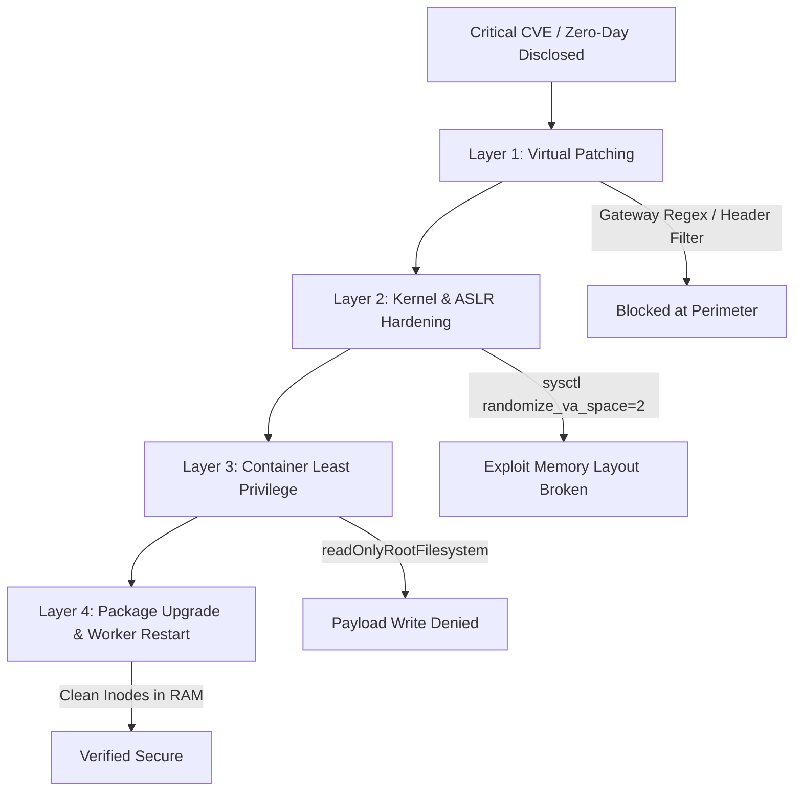

# CVE Remediation & Hardening Orchestrator (`cve-remediation-orchestrator`)

An enterprise security skill that coordinates four-layer defensive mitigations for critical CVEs, neutralizing attack vectors at the architecture, kernel, and gateway levels without referencing or running exploit scripts.

## Core Philosophy: Exploit-Agnostic Defense

Rather than tracking fragile or dangerous exploit PoCs, this skill enforces **architectural invariants** that render entire vulnerability classes inoperable:
1. **Virtual Patching**: Block malformed stream headers and buffer boundary exploits at the API gateway or WAF before they reach the runtime.
2. **Kernel & Host Hardening**: Enforce Full Address Space Layout Randomization (ASLR), Data Execution Prevention (DEP/NX), and strict Seccomp profiles to thwart memory exploitation primitives.
3. **Container Confinement**: Apply read-only root filesystems and drop all Linux capabilities to prevent post-exploitation persistence.
4. **Permanent Remediation**: Verify vendor package upgrades and ensure web worker daemons (`php-fpm`, `nginx`, `apache2`) are restarted so no stale vulnerable inodes remain mapped in RAM.

---

## Defense-in-Depth Architecture



---

## Key CVE Case Studies & Mitigation Playbooks (October 21–22)

### 1. Python CPython `venv` Command Injection (CVE-2024-9287)
* **Disclosed**: October 22
* **Component**: Standard library `venv` module and CLI activation scripts (`bin/activate`, `activate.csh`, `activate.fish`).
* **Root Cause**: Virtual environment path names supplied during environment creation were not properly quoted, allowing command injection into activation scripts.
* **Attack Vector**: Sourcing an attacker-controlled virtual environment (`source venv/bin/activate`) executes embedded shell commands with the user's privileges.
* **Defensive Mitigation**:
  1. **Direct Invocation Protocol**: Never run `source venv/bin/activate` on untrusted workspaces or external repos. Instead, invoke the interpreter directly:
     ```bash
     ./venv/bin/python script.py
     ```
     As confirmed by the Python Software Foundation, direct execution is **unaffected** by CVE-2024-9287.
  2. **Activation Script Sanitizer**:
     Verify activation scripts contain no unquoted path expansions or command separators (`$()`, `;`, `&&`):
     ```bash
     grep -E 'VIRTUAL_ENV=.*[`$;|&]' venv/bin/activate*
     ```
  3. **Runtime Upgrades**: Ensure CPython is upgraded to patched releases: `3.10.16+`, `3.11.11+`, `3.12.8+`, or `3.13.1+`.

---

### 2. PHP Core Remote Code Execution & Memory Exposure (PHP2Shell: CVE-2026-109618 / CVE-2026-109619)
* **Disclosed**: October 21
* **Component**: Stream handling and buffer boundary management.
* **Defensive Mitigation**:
  - Run zero-install remote header audit: `everything-gemini phpcheck https://example.com`.
  - Audit local host and check for unlinked memory handles: `everything-gemini phpcheck --server`.
  - Restart daemon pools: `sudo systemctl restart 'php*-fpm'`.

---

### 3. Spring WebFlux Static Resource Authorization Bypass (CVE-2024-38821)
* **Disclosed**: October 22
* **Component**: Spring WebFlux with Spring Security authorization rules on static resources.
* **Defensive Mitigation**:
  - Enforce perimeter path matching in Envoy AI Gateway or reverse proxy before hitting Spring WebFlux.
  - Upgrade Spring Security to patched releases (`6.3.4+`, `6.2.7+`, `5.8.15+`).

---

## Automated Defense & Hardening Verification Script

Run the automated host hardening and CVE verification script:

```bash
# Terminal human report
bash skills/cve-remediation-orchestrator/scripts/verify-host-hardening.sh

# CI/CD JSON telemetry
bash skills/cve-remediation-orchestrator/scripts/verify-host-hardening.sh --json
```

---

## Related Skills
- [phpcheck-server](file:///Users/salmanshaikh/development/github/everything-gemini/skills/phpcheck-server/SKILL.md) - Deep server and package backport auditor.
- [security-audit](file:///Users/salmanshaikh/development/github/everything-gemini/skills/security-audit/SKILL.md) - General code, dependency, and vulnerability analysis.
- [envoy-ai-gateway](file:///Users/salmanshaikh/development/github/everything-gemini/skills/envoy-ai-gateway/SKILL.md) - Production AI gateway routing, rate limiting, and virtual patching.
