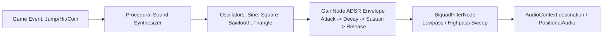

# Game Audio Synthesizer (`game-audio-synthesizer`)

The **Game Audio Synthesizer** skill equips game projects with rich, zero-download procedural sound effects and dynamic background music using the browser's native **Web Audio API** and Three.js audio integration.

---

## 🎧 Procedural Audio Signal Architecture



---

## 🔊 Standalone Procedural SFX Engine (TypeScript)

This zero-dependency synthesizer creates crisp arcade sound effects instantly in memory:

```typescript
export class ProceduralSoundEngine {
  private ctx: AudioContext | null = null;

  private initContext(): AudioContext {
    if (!this.ctx) {
      const AudioCtx = window.AudioContext || (window as any).webkitAudioContext;
      this.ctx = new AudioCtx();
    }
    if (this.ctx.state === 'suspended') {
      this.ctx.resume();
    }
    return this.ctx;
  }

  /**
   * High-pitch rewarding pickup chime (Coin / Checkpoint)
   */
  public playCoin(): void {
    const ctx = this.initContext();
    const now = ctx.currentTime;
    const osc = ctx.createOscillator();
    const gain = ctx.createGain();

    osc.type = 'sine';
    // Arpeggio frequency sweep: 987Hz (B5) -> 1318Hz (E6)
    osc.frequency.setValueAtTime(987.77, now);
    osc.frequency.setValueAtTime(1318.51, now + 0.08);

    gain.gain.setValueAtTime(0.3, now);
    gain.gain.exponentialRampToValueAtTime(0.001, now + 0.35);

    osc.connect(gain);
    gain.connect(ctx.destination);

    osc.start(now);
    osc.stop(now + 0.35);
  }

  /**
   * Upward frequency glide (Jump)
   */
  public playJump(): void {
    const ctx = this.initContext();
    const now = ctx.currentTime;
    const osc = ctx.createOscillator();
    const gain = ctx.createGain();

    osc.type = 'square';
    osc.frequency.setValueAtTime(150, now);
    osc.frequency.exponentialRampToValueAtTime(600, now + 0.15);

    gain.gain.setValueAtTime(0.2, now);
    gain.gain.exponentialRampToValueAtTime(0.001, now + 0.2);

    osc.connect(gain);
    gain.connect(ctx.destination);

    osc.start(now);
    osc.stop(now + 0.2);
  }

  /**
   * White noise burst with lowpass frequency filter (Explosion / Impact)
   */
  public playExplosion(): void {
    const ctx = this.initContext();
    const now = ctx.currentTime;
    const bufferSize = ctx.sampleRate * 0.5;
    const buffer = ctx.createBuffer(1, bufferSize, ctx.sampleRate);
    const output = buffer.getChannelData(0);

    // Generate white noise
    for (let i = 0; i < bufferSize; i++) {
      output[i] = Math.random() * 2 - 1;
    }

    const whiteNoise = ctx.createBufferSource();
    whiteNoise.buffer = buffer;

    const filter = ctx.createBiquadFilter();
    filter.type = 'lowpass';
    filter.frequency.setValueAtTime(800, now);
    filter.frequency.exponentialRampToValueAtTime(50, now + 0.5);

    const gain = ctx.createGain();
    gain.gain.setValueAtTime(0.4, now);
    gain.gain.exponentialRampToValueAtTime(0.001, now + 0.5);

    whiteNoise.connect(filter);
    filter.connect(gain);
    gain.connect(ctx.destination);

    whiteNoise.start(now);
    whiteNoise.stop(now + 0.5);
  }

  /**
   * Continuous frequency modulated engine drone
   */
  public createEngineHum(): { setSpeed: (normalized: number) => void; stop: () => void } {
    const ctx = this.initContext();
    const osc = ctx.createOscillator();
    const gain = ctx.createGain();

    osc.type = 'sawtooth';
    osc.frequency.setValueAtTime(45, ctx.currentTime);
    gain.gain.setValueAtTime(0.08, ctx.currentTime);

    osc.connect(gain);
    gain.connect(ctx.destination);
    osc.start();

    return {
      setSpeed: (norm: number) => {
        const clamped = Math.max(0, Math.min(1, norm));
        osc.frequency.setTargetAtTime(45 + clamped * 120, ctx.currentTime, 0.05);
      },
      stop: () => {
        gain.gain.setTargetAtTime(0, ctx.currentTime, 0.05);
        setTimeout(() => osc.stop(), 100);
      }
    };
  }
}
```

---

## 🌐 3D Spatial Audio Integration with Three.js

For games with position-dependent sounds (e.g. passing vehicles, ambient fountains):

```typescript
import * as THREE from 'three';

export function attachSpatialAudio(
  camera: THREE.Camera,
  targetMesh: THREE.Mesh
): void {
  // 1. Attach AudioListener to Camera
  const listener = new THREE.AudioListener();
  camera.add(listener);

  // 2. Create Positional Audio Source
  const sound = new THREE.PositionalAudio(listener);
  const audioCtx = listener.context;

  // Synthesize procedural tone directly into AudioBuffer
  const buffer = audioCtx.createBuffer(1, audioCtx.sampleRate * 0.2, audioCtx.sampleRate);
  const data = buffer.getChannelData(0);
  for (let i = 0; i < data.length; i++) {
    data[i] = Math.sin(2 * Math.PI * 440 * (i / audioCtx.sampleRate)) * Math.exp(-i / (audioCtx.sampleRate * 0.05));
  }

  sound.setBuffer(buffer);
  sound.setRefDistance(5);
  sound.setMaxDistance(50);
  targetMesh.add(sound);

  // Play on event
  sound.play();
}
```

