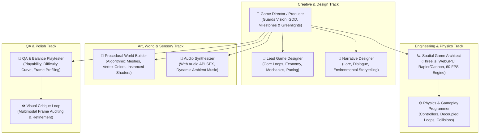

# Game Studio Orchestrator (`game-studio`)

The **Game Studio Orchestrator** transforms Google Antigravity and Gemini into an autonomous multi-role game development studio (inspired by studio hierarchies like *Claude-Code-Game-Studios* and elevated with Gemini 4 Argon's spatial reasoning). It coordinates creative vision, engine programming, procedural world generation, audio synthesis, and quality assurance into a disciplined production pipeline.

---

## 🏛️ Virtual Game Studio Organizational Hierarchy



---

## 📋 The 5-Phase Studio Production Lifecycle

### Phase 0: High Concept & Pitch Matrix
Before writing code, the studio establishes the game's foundation:
- **One-Sentence Hook**: What makes this game immediately compelling?
- **The 3 Core Pillars**: Non-negotiable design principles that every feature must support.
- **Target Emotion**: What should the player feel? (e.g., *Kinetic momentum, claustrophobic dread, puzzle mastery*).

### Phase 1: Game Design Document (GDD) Standardization
Every project begins with a structured GDD stored in `docs/gdd/<title>.md`:
1. **High Concept & Core Hook**
2. **Core Gameplay Loop**: `Action -> Feedback -> Reward -> Progression`
3. **Mechanics & Controls Specification**: Primary inputs (WASD, Mouse, Touch), velocities, jump curves, acceleration.
4. **World & Level Architecture**: Spatial scale, boundaries, obstacles, collectible placement.
5. **Aesthetic Direction**: Color palette, lighting atmosphere, shader effects, camera perspective.
6. **Audio Landscape**: Ambient soundscapes, interactive SFX cues, dynamic musical cues.
7. **Technical Specifications**: Frame rate target (60 FPS), draw call ceiling ($< 100$), memory disposal rules.

### Phase 2: Technical Sandbox & Physics Greybox
The [`spatial-game-architect`](../../agents/spatial-game-architect.md) constructs a playable greybox:
- Decoupled fixed-timestep loop (60Hz physics accumulator).
- Player controller with responsive input handling.
- Placeholder bounding boxes and collision volumes.

### Phase 3: Procedural Assets & World Synthesis
The studio avoids multi-megabyte 3D downloads by leveraging procedural synthesis:
- [`argon-procedural-asset-generator`](../argon-procedural-asset-generator/SKILL.md): Algorithmic terrain heightmaps, vertex-colored meshes, and `InstancedMesh` scattering.
- Procedural canvas textures and custom GLSL/TSL shaders.

### Phase 4: Procedural Audio & Sensory Feedback
The studio equips the game with rich sensory feedback:
- [`game-audio-synthesizer`](../game-audio-synthesizer/SKILL.md): Pure Web Audio API procedural synthesis for lasers, jumps, explosions, coin chimes, and ambient music without external audio files.

### Phase 5: Studio Critique & Gold Master Gate
Before certifying release, the studio conducts a multi-lens review:
- **Design Review**: Is the core loop intuitive within the first 5 seconds?
- **Visual Critique**: [`argon-visual-critique-loop`](../argon-visual-critique-loop/SKILL.md) audits camera framing, lighting contrast, and shadow acne.
- **Performance Audit**: Does the game maintain $\ge 60\text{ FPS}$ with zero WebGL memory leaks?

---

## 🛠️ CLI Studio Workflow

Everything Gemini provides native CLI commands to orchestrate your studio:

```bash
# 1. Draft a complete Game Design Document (GDD)
everything-gemini game-studio gdd "neon-drifter"

# 2. Generate a phased milestone sprint plan
everything-gemini game-studio plan "neon-drifter"

# 3. Audit game codebase against 60 FPS budgets and memory disposal
everything-gemini game-studio audit

# 4. Initialize a complete playable 3D game template
everything-gemini game-studio init desk-racer
```

---

## 🎮 Subagent Delegation Cheat-Sheet

When building games in Antigravity, delegate according to department expertise:

| Department Task | Assigned Subagent / Skill | Key Deliverables |
| :--- | :--- | :--- |
| **Vision & Production** | `game-director` | Comprehensive GDD, Milestone tracking, Release sign-off. |
| **Engine & Scene Graph** | `spatial-game-architect` | Three.js / WebGPU renderer, camera rigs, post-processing. |
| **Physics & Controller** | `argon-3d-game-engine` | Fixed 60Hz physics loop, arcade controller, collision matrix. |
| **Procedural Assets** | `argon-procedural-asset-generator` | Terrain meshes, low-poly vehicles, procedural textures. |
| **Audio & SFX** | `game-audio-synthesizer` | Web Audio API procedural sound effects & background music. |
| **Visual QA** | `argon-visual-critique-loop` | Canvas snapshot critique, shadow bias, PBR material tuning. |
| **Automated Playtesting** | `browser-qa` | Automated browser navigation, keypress simulation, WebP capture. |

