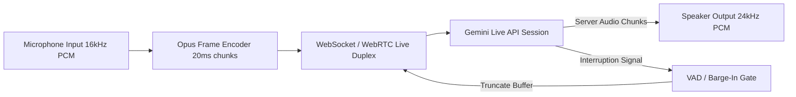

# Gemini Live Audio Transcriber & Speech Duplex (`gemini-live-audio-transcriber`)

This skill provides an enterprise client and server implementation for streaming bidirectional audio with Gemini Live API (WebSocket & WebRTC), providing sub-150ms speech-to-text (STT) and text-to-speech (TTS) pair-programming loops.

---

## 🎙️ Streaming Audio Pipeline Architecture



---

## ⚙️ Connection & Protocol Specification

### WebSocket Handshake Configuration
```json
{
  "setup": {
    "model": "models/gemini-2.0-flash-exp",
    "generation_config": {
      "response_modalities": ["AUDIO", "TEXT"],
      "speech_config": {
        "voice_config": {
          "prebuilt_voice_config": {
            "voice_name": "Aoede"
          }
        }
      }
    },
    "system_instruction": {
      "parts": [{ "text": "You are Antigravity Pair Programmer. Speak concisely, direct errors accurately, and interrupt when syntax fails." }]
    }
  }
}
```

---

## 💻 Node.js Low-Latency Audio Streaming Loop

```javascript
import WebSocket from 'ws';

export class GeminiLiveAudioClient {
  constructor(apiKey, host = 'generativelanguage.googleapis.com') {
    this.wsUrl = `wss://${host}/ws/google.ai.generativelanguage.v1alpha.GenerativeService.BidiGenerateContent?key=${apiKey}`;
    this.ws = null;
  }

  connect() {
    this.ws = new WebSocket(this.wsUrl);
    this.ws.on('open', () => this.sendInitialSetup());
    this.ws.on('message', (data) => this.handleIncomingMessage(data));
  }

  sendInitialSetup() {
    const setupMsg = {
      setup: {
        model: 'models/gemini-2.0-flash-exp',
        generation_config: { response_modalities: ['AUDIO', 'TEXT'] }
      }
    };
    this.ws.send(JSON.stringify(setupMsg));
  }

  sendAudioChunk(pcmChunkBuffer) {
    const base64Audio = pcmChunkBuffer.toString('base64');
    const realtimeInput = {
      realtime_input: {
        media_chunks: [
          {
            mime_type: 'audio/pcm;rate=16000',
            data: base64Audio
          }
        ]
      }
    };
    this.ws.send(JSON.stringify(realtimeInput));
  }

  handleIncomingMessage(raw) {
    const msg = JSON.parse(raw);
    if (msg.serverContent?.interrupted) {
      console.log('⚡ Barge-in detected: User interrupted AI playback');
      this.flushAudioBuffers();
    }
  }

  flushAudioBuffers() {
    // Clear playback buffer instantly
  }
}
```

---

## 🚀 Key Operational Invariants
1. **Sample Rate Standardization**: Mic input MUST be 16,000 Hz single-channel PCM; model audio response is 24,000 Hz PCM.
2. **20ms Frame Chunking**: Send audio chunks every 20ms (320 samples / 640 bytes) to maintain sub-200ms latency.
3. **Barge-In Handling**: Listen for `serverContent.interrupted: true` and instantly discard pending playback frames.
