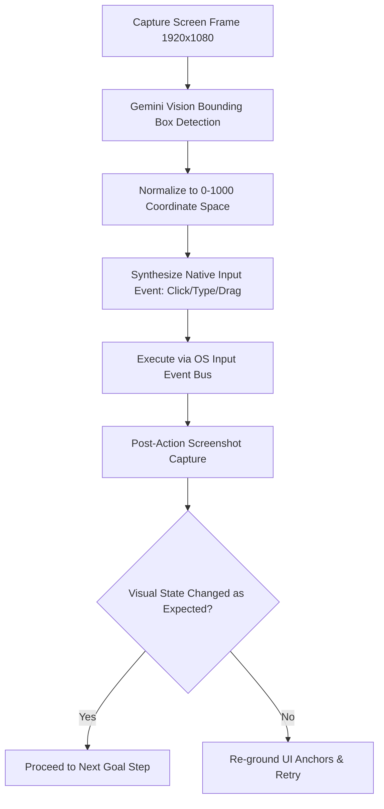

# Multimodal Screen Actor & Desktop Action Loop (`multi-modal-screen-actor`)

The **Multimodal Screen Actor** enables autonomous computer-use and GUI automation across Google Antigravity Desktop 2.0, translating visual screen captures into normalized $(x, y)$ coordinate actions with post-action perceptual verification.

---

## 🖥️ Screen Action Execution Loop



---

## 🎯 Coordinate Normalization Protocol

To achieve resolution-independent computer use across Retina/4K displays:
$$\text{ScreenX} = \text{round}\left(\frac{\text{NormX}}{1000} \times \text{DisplayWidth}\right)$$
$$\text{ScreenY} = \text{round}\left(\frac{\text{NormY}}{1000} \times \text{DisplayHeight}\right)$$

---

## 💻 Action Schema & Python Implementation

```python
from typing import TypedDict, Literal
import json

class ScreenAction(TypedDict):
    action: Literal["click", "double_click", "move", "type", "key_combination", "scroll"]
    x: int  # 0 to 1000
    y: int  # 0 to 1000
    text: str | None
    keys: list[str] | None

def execute_screen_action(action: ScreenAction, screen_width: int, screen_height: int):
    # Convert normalized coordinates to absolute pixels
    abs_x = int((action["x"] / 1000.0) * screen_width)
    abs_y = int((action["y"] / 1000.0) * screen_height)

    if action["action"] == "click":
        print(f"🖱️ Clicking at ({abs_x}, {abs_y})")
        # Native OS click execution
    elif action["action"] == "type" and action["text"]:
        print(f"⌨️ Typing: {action['text']}")
        # Native OS keystroke dispatch
    elif action["action"] == "key_combination" and action["keys"]:
        print(f"⌨️ Key combination: {' + '.join(action['keys'])}")
        # Send modifier keys
```

---

## 🛡️ Safety Invariants
1. **Never Click into Unknown Credential Prompts**: Intercept system sudo/OAuth modals and escalate to `human-gate` hook.
2. **Visual Delta Verification**: Every mutation must be validated against a subsequent screenshot to confirm button depression or modal dismissal.
