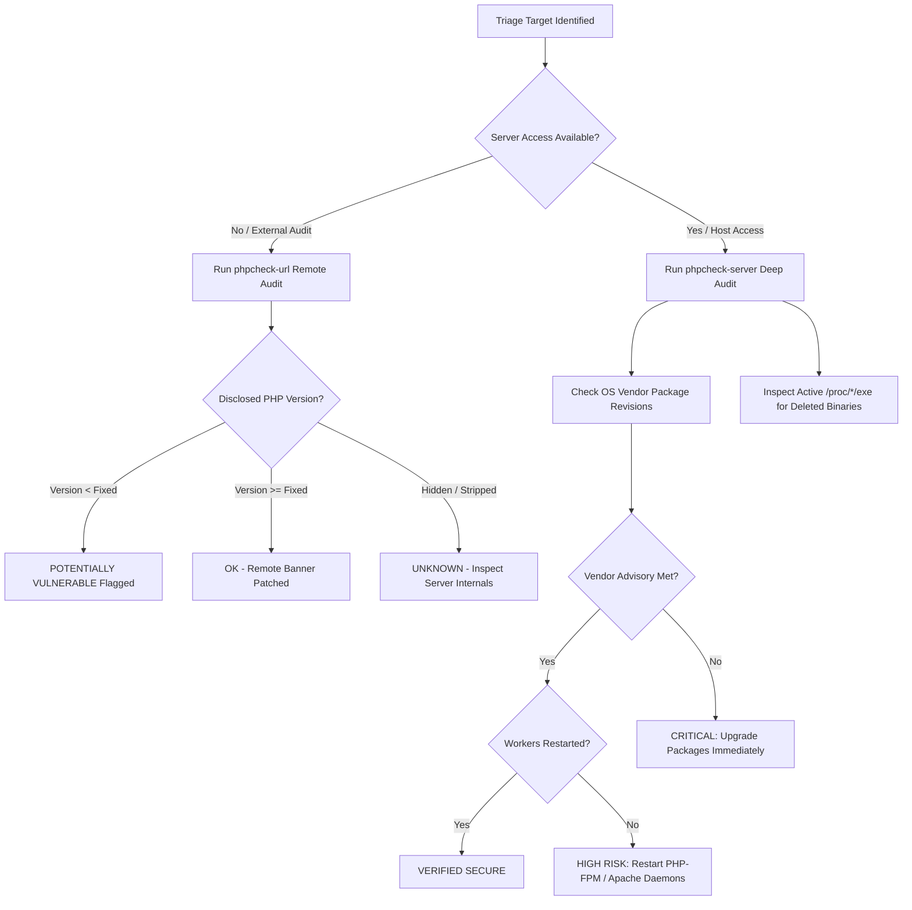

# PHP2Shell Vulnerability & Patch Auditor (`php2shell-version-auditor`)

An enterprise-grade, non-intrusive security auditor and fleet triage runbook for **PHP2Shell** (**CVE-2026-109618** and **CVE-2026-109619**), rated CVSS 9.2 (Critical Remote Code Execution and Memory Exposure).

## Vulnerability Overview
On October 21, 2026, the PHP core security team and upstream maintainers disclosed two critical vulnerabilities affecting standard PHP runtimes across all unpatched branches:
- **CVE-2026-109618**: Remote memory corruption and execution vulnerability in stream handling and buffer boundaries.
- **CVE-2026-109619**: Out-of-bounds read and memory disclosure enabling authorization bypass or remote execution.

Upstream patched releases: **8.2.35**, **8.3.36**, **8.4.27**, and **8.5.12**. Older unmaintained branches (5.4–5.6, 7.0–7.4, 8.0, 8.1) are inherently vulnerable unless protected by vendor enterprise backports (Ubuntu Pro, Red Hat ELS).

---

## Defensive Triage Lifecycle



---

## Sub-Skills & Components
This skill coordinates two specialized audit sub-skills:
1. [phpcheck-url](file:///Users/salmanshaikh/development/github/everything-gemini/skills/phpcheck-url/SKILL.md): Fast, non-intrusive HTTP header scanner for remote websites and API gateways.
2. [phpcheck-server](file:///Users/salmanshaikh/development/github/everything-gemini/skills/phpcheck-server/SKILL.md): Host and container scanner checking `dpkg`/`rpm` package revisions and running memory process states.

---

## Zero-Install Audit Commands

### Remote Target Audit
```bash
# Terminal execution via Everything Gemini CLI
everything-gemini phpcheck "https://example.com"

# JSON telemetry output for automated CI/CD pipelines
everything-gemini phpcheck "https://example.com" --json
```

### Server / Container Fleet Audit
```bash
# Run server audit
everything-gemini phpcheck --server

# Or run the native shell script
bash skills/phpcheck-server/scripts/audit-server.sh
```

---

## Remediation Checklist

1. **Update Packages**:
   - Ubuntu / Debian: `sudo apt update && sudo apt install --only-upgrade php*-fpm php*-cli libapache2-mod-php*`
   - RHEL / Rocky / Alma: `sudo dnf update php\*`
2. **Restart Daemons (Mandatory)**:
   ```bash
   sudo systemctl restart 'php*-fpm'
   sudo systemctl restart apache2 || sudo systemctl restart nginx
   ```
3. **Verify Active Process RAM**:
   ```bash
   ls -l /proc/*/exe 2>/dev/null | grep -E '(php|apache|httpd).*\(deleted\)'
   # Must return 0 lines!
   ```
4. **Harden HTTP Headers**:
   In `php.ini`, set:
   ```ini
   expose_php = Off
   ```
   In `nginx.conf`:
   ```nginx
   server_tokens off;
   ```
