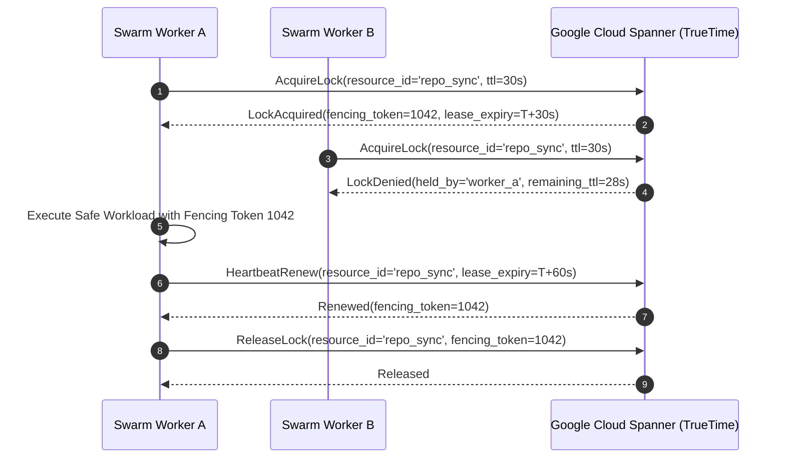

# Spanner Distributed Locks & Lease Manager (`spanner-distributed-locks`)

This skill provides production patterns for distributed mutual exclusion, leader election, and fencing tokens across multi-agent swarms and microservices backed by **Google Cloud Spanner**'s externally consistent TrueTime architecture.

---

## 🏛️ Locking Architecture & Fencing Tokens



---

## 💾 Schema Definition (DDL)

```sql
CREATE TABLE DistributedLocks (
  ResourceId STRING(128) NOT NULL,
  OwnerId STRING(128) NOT NULL,
  FencingToken INT64 NOT NULL,
  AcquiredAt TIMESTAMP NOT NULL OPTIONS (allow_commit_timestamp = true),
  ExpiresAt TIMESTAMP NOT NULL,
  Metadata JSON
) PRIMARY KEY (ResourceId);
```

---

## 💻 Python Production Implementation

```python
from google.cloud import spanner
from datetime import datetime, timedelta, timezone

def acquire_or_renew_lock(transaction, resource_id: str, owner_id: str, lease_seconds: int = 30):
    query = """
    SELECT OwnerId, FencingToken, ExpiresAt 
    FROM DistributedLocks 
    WHERE ResourceId = @resource_id
    """
    results = list(transaction.execute_sql(query, params={"resource_id": resource_id}))
    now = datetime.now(timezone.utc)
    expires = now + timedelta(seconds=lease_seconds)

    if not results:
        # Initial lock acquisition
        transaction.execute_update(
            """
            INSERT INTO DistributedLocks (ResourceId, OwnerId, FencingToken, AcquiredAt, ExpiresAt)
            VALUES (@res, @owner, 1, PENDING_COMMIT_TIMESTAMP(), @exp)
            """,
            params={"res": resource_id, "owner": owner_id, "exp": expires}
        )
        return True, 1

    row = results[0]
    current_owner, token, current_exp = row[0], row[1], row[2]

    if current_owner == owner_id or now > current_exp:
        new_token = token + 1
        transaction.execute_update(
            """
            UPDATE DistributedLocks 
            SET OwnerId = @owner, FencingToken = @token, ExpiresAt = @exp, AcquiredAt = PENDING_COMMIT_TIMESTAMP()
            WHERE ResourceId = @res AND FencingToken = @old_token
            """,
            params={"res": resource_id, "owner": owner_id, "token": new_token, "exp": expires, "old_token": token}
        )
        return True, new_token
    
    return False, token
```

---

## 🛡️ Anti-Patterns & Invariants
- ❌ **Never rely on client-side wall clocks**: Always compare expiration against TrueTime `PENDING_COMMIT_TIMESTAMP()` or database server timestamps.
- ✅ **Always validate the Fencing Token**: Storage layers downstream must reject writes presenting stale fencing tokens to prevent zombie split-brain writes.
