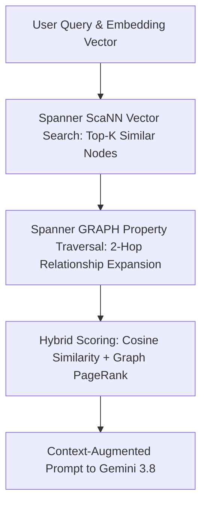

# Spanner Vector Search & Hybrid Graph RAG (`spanner-vector-search`)

This skill provides production schemas, indexing strategies, and hybrid query templates for executing sub-10ms Approximate Nearest Neighbor (ANN) vector search natively inside **Google Cloud Spanner**, seamlessly combined with property graph traversals (Graph RAG).

---

## 🏛️ Hybrid Vector + Graph Search Architecture



---

## 💾 Schema Definition with Vector Indexes (DDL)

```sql
CREATE TABLE DocumentChunks (
  ChunkId STRING(64) NOT NULL,
  DocumentId STRING(64) NOT NULL,
  Content STRING(MAX) NOT NULL,
  Embedding ARRAY<FLOAT32>(vector_length=>768) NOT NULL,
  CreatedAt TIMESTAMP OPTIONS (allow_commit_timestamp = true)
) PRIMARY KEY (ChunkId);

-- Native ScaNN Vector Search Index
CREATE SEARCH INDEX DocumentChunkVectorIndex ON DocumentChunks(
  Embedding OPTIONS (distance_type = 'COSINE', index_type = 'SCANN')
);
```

---

## 🔍 Hybrid SQL Query Example

```sql
SELECT 
  d.DocumentId,
  c.ChunkId,
  c.Content,
  COSINE_DISTANCE(c.Embedding, @query_embedding) AS Distance
FROM DocumentChunks AS c
JOIN Documents AS d ON c.DocumentId = d.DocumentId
WHERE COSINE_DISTANCE(c.Embedding, @query_embedding) < 0.25
ORDER BY Distance ASC
LIMIT 10;
```

---

## 🚀 Combined Graph RAG Traversal

Combine vector similarity with Spanner Graph patterns:
```sql
GRAPH KnowledgeGraph
MATCH (a:Entity)-[r:DEPENDS_ON]->(b:Entity)
WHERE a.ChunkId IN (
  SELECT ChunkId FROM DocumentChunks 
  ORDER BY COSINE_DISTANCE(Embedding, @query_vector) ASC LIMIT 5
)
RETURN a.Name, TYPE(r), b.Name;
```

---

## 🎯 Best Practices
1. **Pre-filter with Partition Keys**: Scope vector distance calculations using indexed tenant/project partition keys.
2. **Dimension Matching**: Ensure embedding array lengths strictly match the model output (e.g., 768 for `text-embedding-004`).
3. **Use ScaNN Indexing**: Utilize Google ScaNN index type for $10\times$ faster QPS over brute-force KNN scans.
