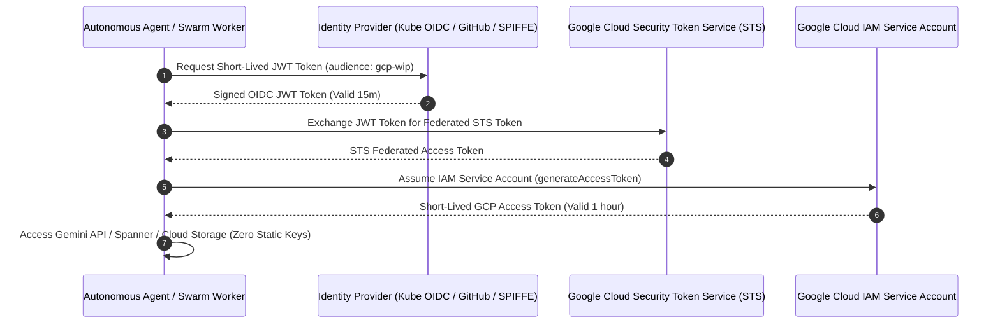

# Zero-Trust Workload Identity Federation (`zero-trust-workload-identity`)

This skill enforces keyless, zero-trust cryptographic authentication across autonomous agent swarms, Kubernetes microservices, and external cloud environments using **Google Cloud Workload Identity Federation** and **Security Token Service (STS)**.

---

## 🔐 Keyless Authentication Workflow



---

## 🛠️ Infrastructure as Code (Terraform / gcloud)

### 1. Workload Identity Pool & Provider Setup
```bash
# 1. Create the Workload Identity Pool
gcloud iam workload-identity-pools create "agent-swarm-pool" \
  --project="my-enterprise-project" \
  --location="global" \
  --display-name="Autonomous Agent Swarm Pool"

# 2. Add an OIDC Provider for Kubernetes / GitHub
gcloud iam workload-identity-pools providers create-oidc "k8s-agent-provider" \
  --project="my-enterprise-project" \
  --location="global" \
  --workload-identity-pool="agent-swarm-pool" \
  --issuer-uri="https://container.googleapis.com/v1/projects/my-enterprise-project/locations/us-central1/clusters/prod-cluster" \
  --attribute-mapping="google.subject=assertion.sub,attribute.namespace=assertion['kubernetes.io']['namespace']"
```

---

## 💻 Python Keyless Credential Resolver

```python
from google.auth import identity_pool
import requests

def get_federated_credentials(audience_url: str, sa_email: str):
    # Load short-lived K8s service account token
    with open("/var/run/secrets/kubernetes.io/serviceaccount/token", "r") as f:
        k8s_token = f.read().strip()

    # Exchange K8s token for Google STS token
    credentials = identity_pool.Credentials.from_info({
        "type": "external_account",
        "audience": audience_url,
        "subject_token_type": "urn:ietf:params:oauth:token-type:jwt",
        "token_url": "https://sts.googleapis.com/v1/token",
        "credential_source": {
            "file": "/var/run/secrets/kubernetes.io/serviceaccount/token"
        },
        "service_account_impersonation_url": f"https://iamcredentials.googleapis.com/v1/projects/-/serviceAccounts/{sa_email}:generateAccessToken"
    })
    
    return credentials
```

---

## 🛡️ Security Invariants
- ❌ **Zero Service Account Keys**: Strictly forbid creating or downloading `.json` service account keys (`iam.serviceAccountKeys.create` prohibited by Org Policy).
- ✅ **Short Token Lifetimes**: Enforce STS tokens with maximum lifetimes of 60 minutes.
- ✅ **Namespace Isolation**: Attribute conditions MUST strictly validate `attribute.namespace == 'agent-system'`.
